# MAGI-2 Preview 模型技术分析报告

> 基于仓库源代码逐文件分析。所有结论均标注对应代码位置（`path:line`），可逐一回溯核对。
> 仓库定位：**仅推理代码**（不含训练系统）。模型权重需从 HuggingFace `sand-ai/MAGI-2-preview` 下载到 `ckpt/`。

## 图解索引

本文档包含 17 幅 Mermaid 图，覆盖模型架构、组件结构、并行策略、推理流程：

| # | 图名 | 类型 | 位置 |
| --- | --- | --- | --- |
| 1 | 两阶段生成总览（Prompt→Preview→Refiner→解码→mp4） | flowchart | 一、模型总览 |
| 2 | 整体模型架构（PreAdapter→TransformerBlock→PostAdapter） | flowchart | 2.1 整体结构 |
| 3 | Token 序列拼接布局与坐标映射 | flowchart | 2.3 输入编码 |
| 4 | TransformerLayer 内部结构（MHC+Attention+MoE 4流） | flowchart | 2.5 MHC 组件 |
| 5 | Attention 内部结构（FA3+sink+gating+Ulysses CP） | flowchart | 2.4 Attention 组件 |
| 6 | MHC Hyper-Connect 数据流（h_post+h_res 混合） | flowchart | 2.5 MHC 组件 |
| 7 | MoE Layer 结构（稀疏专家+共享专家并行） | flowchart | 2.6.1 MultiHeadMoELayer |
| 8 | MoE 路由与 Flash Triton Kernel 流程 | flowchart | 2.6.2 CoreMultiHeadMoE |
| 9 | 并行策略总览（8卡 CP/EP 组关系+权重分布） | flowchart×2 | 3.2.1 并行配置 |
| 10 | Ulysses CP 在 Attention 中的 all-to-all | flowchart | 3.2.3 Context Parallel |
| 11 | CP+EP 组合数据流（dispatch→MoE→undispatch） | flowchart | 3.3.2 EP Dispatch |
| 12 | 端到端推理流程总图 | flowchart | 四、端到端示例 |
| 13 | Preview 去噪循环详细步骤 | flowchart | 4.3 Preview 阶段 |
| 14 | Refiner 阶段精修流程 | flowchart | 4.4 Refiner 阶段 |
| 15 | Checkpoint 加载与 Offload 时序 | sequenceDiagram | 4.1 初始化 |
| 16 | EP 权重分片加载流程 | flowchart | 3.3.1 EP 权重分片 |

---

## 一、模型总览

MAGI-2 Preview 是 SandAI 推出的 **114B 参数统一音视频生成模型**，每个 token 仅激活约 **6B** 参数（MagiMoE 稀疏路由）。它从文本（T2V）或文本+首帧图像（I2V）生成 **10 秒**带声音的视频片段。生成分两阶段：

```mermaid
flowchart LR
    P["Prompt + 可选首帧图像"]
    TE["Qwen3.5-27B<br/>文本编码"]
    P --> PE["Prompt Enhancement<br/>(可选, LLM 改写)"]
    PE --> TE

    subgraph S1["阶段一：Preview 去噪"]

        NL["噪声 latent<br/>512×896, 100步"]
        P1["magi2_preview DiT<br/>40层 + MagiMoE<br/>100 步 FlowUniPC"]
        NL --> P1
        PL["preview latent<br/>(低分辨率)"]
        P1 --> PL
    end

    TE --> S1

    subgraph S2["阶段二：Refiner 超分"]

        UP["三线性插值上采样<br/>→ 1920×1088"]
        NZ["加噪 (sigma@t=220)"]
        P2["magi2_refiner DiT<br/>30层 稠密 MLP<br/>5 步 FlowUniPC"]
        UP --> NZ --> P2
        RL["refiner latent<br/>(1080p)"]
        P2 --> RL
    end

    PL --> UP

    subgraph S3["解码与合成"]

        VD["Turbo VAE 解码<br/>→ 视频帧 (25fps)"]
        AD["Stable Audio VAE 解码<br/>→ 波形 + sinc 重采样"]
        MX["ffmpeg mux<br/>音视频合并"]
        OUT["sample_000.mp4<br/>(1080p, 10s, 带声)"]
        VD --> MX
        AD --> MX
        MX --> OUT
    end

    RL --> VD
    RL --> AD
```

| 阶段 | 模型 | 角色 | 分辨率 | 去噪步数 | 权重大小 |
| --- | --- | --- | --- | --- | --- |
| Preview | `magi2_preview` | 低分辨率去噪（DiT + MagiMoE） | 512×896 latent | 100 步 | 228 GB |
| Refiner | `magi2_refiner` | 超分辨率精修（DiT 稠密 MLP） | 1088×1920 (1080p) | 5 步 | 14 GB |

来源：`README.md:14-29`、`README.md:77-117`、`configs/magi2_preview.json`、`configs/magi2_refiner.json`。

辅助组件权重：

| 组件 | 来源 | 作用 |
| --- | --- | --- |
| 文本编码器 | Qwen3.5-27B（56 GB） | 编码 prompt 为 5120 维特征 |
| 视频 VAE | Wan2.2 VAE（3 GB） | 视频 latent ↔ 像素（stride 8/16/16） |
| 音频 VAE | Stable Audio Open 1.0（5 GB） | 音频 latent ↔ 波形 |
| Turbo VAE | TurboV3 蒸馏解码器（2 GB） | 默认快速视频解码 |

来源：`README.md:110-117`、`inference/model/{vae2_2.py, sa_audio_vae.py, turbo_vaed.py, qwen35.py}`。

---

## 二、模型架构详解

### 2.1 整体结构

MAGI-2 Preview 主干是一个 **多模态 Diffusion Transformer (DiT)**，三模态（视频/音频/文本）token 拼接后统一过 Transformer，输出再按模态拆解。整体结构：

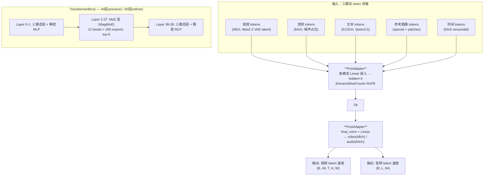

> 每层内部结构：`MHC-pre-attn → Attention → MHC-attn→mlp → MLP/MoE → MHC-post-mlp`（详见 [图4 TransformerLayer 内部结构](#图4)）。

代码：`inference/model/magi2_preview.py:3184-3248`（`Transformer` 类）、`inference/model/magi2_refiner.py:2187-2268`（`Transformer` 类）。

### 2.2 两套架构参数对比

| 参数 | magi2_preview | magi2_refiner | 配置来源 |
| --- | --- | --- | --- |
| num_layers | 40 | 30 | `magi2_preview.json:11` / `magi2_refiner.json:4` |
| hidden_size | 3072 | 4096 | 同上 |
| head_dim | 128 | 128 | 同上 |
| num_query_groups (KV heads) | 24 | 8 | 同上 |
| num_heads_q (Q heads) | 24 | 32 | `magi2_config.py:348-361` 自动推导 |
| video_in_channels | 48 | 48 | |
| audio_in_channels | 64 | 64 | |
| text_in_channels | 5120 | 5120 | |
| intermediate_factor | 4 | — | |
| mm_layers (三模态层) | [0,1,38,39] | [0,1,28,29] | |
| MoE 层 | 2~37 (36 层) | 无（全稠密 MLP） | `magi2_preview.json:46-83` |
| local_attn_layers | — | 全部 0~29 | `magi2_refiner.json:19-50` |
| params_dtype | bfloat16 | bfloat16 | |
| activation | swiglu7 | swiglu7 | |

> 注意：preview 的首尾各 2 层（0,1,38,39）为三模态层（`num_modality=3`），其余为单模态；MoE 层（2~37）始终 `num_modality=3`。见 `magi2_preview.py:2918`。

### 2.3 输入编码（PreAdapter / Adapter）

**PreAdapter**（`magi2_preview.py:2819-2876`）负责将三模态原始特征投影到统一的 `hidden_size * num_stream(4)` 维（virtual_width_factor=4，因 MHC 有 4 流）：

- `video_embedder`: `Linear(48, 3072*4)` — 视频 latent token
- `text_embedder`: `Linear(5120, 3072*4)` — Qwen3.5 文本特征
- `audio_embedder`: `Linear(64, 3072*4)` — 音频 latent token
- `rope`: `ElementWiseFourierEmbed(head_dim=128)` — 基于坐标的逐元素傅里叶位置编码

输入 token 序列拼接顺序（`preview_data_proxy.py:228-256` 的 `modality_map_seqlens`）：

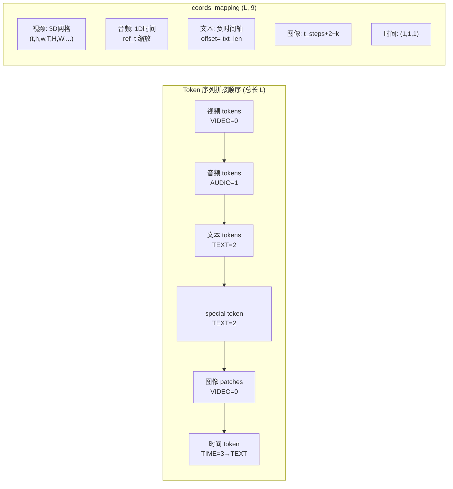

```
[ video_tokens | audio_tokens | text_tokens | (special_token, image_patches)* | time_token? ]
```

- 视频 token：`img2tokens` 用 `UnfoldNd(t_patch=1, patch=1, patch=1)` 展开 latent（`preview_data_proxy.py:586-599`）
- 参考图像（I2V）：经 VAE 编码后 patchify，前面加一个文本编码器产生的 `<Figure N>` special token（`inference_engine.py:373-393`）
- 时间 token：逐 token 的扩散时间步嵌入（`time_channel_dim=64`，`sinusoidal_embedding_1d`），注入到序列中

**坐标映射**（`coords_mapping`，shape `(L, 9)` = `(t,h,w,T,H,W,ref_T,ref_H,ref_W)`，`preview_data_proxy.py:259-334`）：
- 视频用 3D 网格坐标，空间 ref 用 "extra"（即等于自身尺寸，不插值）
- 音频用 1D 时间坐标，ref_t 做魔法缩放 `((L-1)//8+1)//t_patch`
- 文本坐标偏移到负时间轴 `-txt_feat_len`
- 参考图像放在视频之后、时间轴 `t_steps + 2 + k` 处

**模态映射**（`modality_mapping`）：`Modality` 枚举 VIDEO=0, AUDIO=1, TEXT=2, TIME=3（`magi2_preview.py:71-78`）。TIME token 在进入 block 前被重映射为 TEXT（`magi2_preview.py:3224-3226`）。

### 2.4 Attention 组件

**Attention**（`magi2_preview.py:2326-2423`）核心特性：

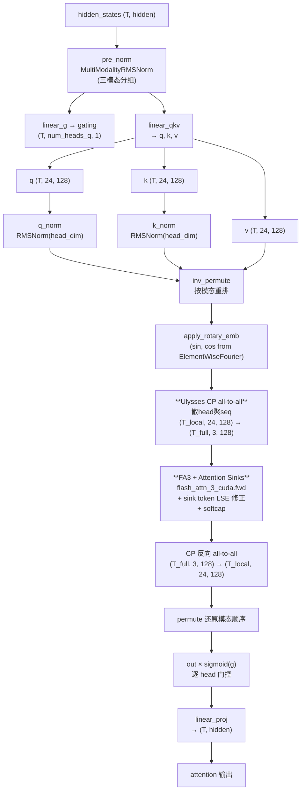

1. **Pre-RMSNorm**：多模态 RMSNorm（`MultiModalityRMSNorm`），三模态层按模态分组归一化，Triton kernel 加速（`magi2_preview.py:497-623`）
2. **QKV 投影**：`linear_qkv` 输出 `[q_size, kv_size, kv_size]`，GQA（Q heads=24, KV heads=24 → preview 实为 MHA；refiner Q=32 KV=8 真 GQA）
3. **Q/K RMSNorm**：对 head_dim 做 RMSNorm（`magi2_preview.py:2375-2380`）
4. **Attention Gating**：`linear_g` 产生逐 head 标量门控，`out * sigmoid(g)`（`magi2_preview.py:2391,2421`，配置 `attn_gating.enable=true`）
5. **Attention Sinks**：每个 head 1 个可学习 sink token，拼在 K/V 前面参与 softmax，sh-layout（`magi2_preview.py:2369-2373`，配置 `attn_sinks.sink_token_num=1`）
6. **RoPE**：`apply_rotary_emb_torch`，interleaved=False，基于 ElementWiseFourierEmbed 生成 sin/cos
7. **FA3 内核**：`flash_attn_3_cuda.fwd`（Hopper 后端）+ `FA3VarlenFuncWithSink` 修正 sink 的 LSE（`magi2_preview.py:2100-2170`）
8. **Varlen**：`cu_seqlens_q/k` 支持变长打包（CFG batch=2 的 cond/uncond 拼成一个 batch）

**Context Parallel (Ulysses)**（`magi2_preview.py:2173-2229`）：
- 注意力前：`batch_scatter_head_gather_seqlen` 做 all-to-all，把 `(S_local, H_all, D)` → `(S_full, H_local, D)`，即**散 head、聚 seq_len**
- 每个 rank 在完整序列、本地 head 子集上做全注意力
- 注意力后：`scatter_seqlen_gather_head` 反向 all-to-all 还原
- 代码：`all_to_all_primitive.py:39-141`

### 2.5 MHC (Multi-Head Connect) 组件

MHC 是 MAGI-2 的核心创新之一（`magi2_preview.py:1942-2057` 的 `MHCHandler`，`magi2_preview.py:2976-3015` 的参数定义）。每个 TransformerLayer 在 Attention 和 MLP 前后都插入 MHC 路由。

<a id="图4"></a>

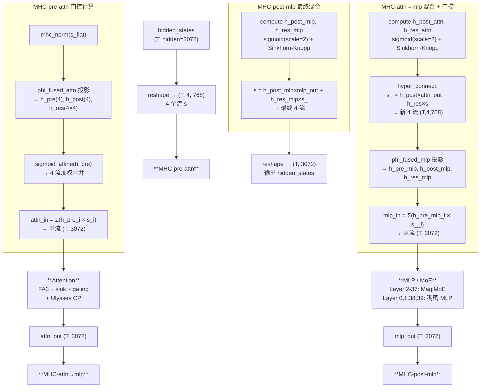

**机制**：hidden_size 被拆成 `num_stream=4` 个流（每个 3072 维）。MHC 学习三组门控矩阵：

- `h_pre` (n=4)：前融合门控，sigmoid 仿射，把 4 流加权合并成单流送入 Attn/MLP
- `h_post` (n=4)：后缩放门控，sigmoid 仿射（scale=2.0），缩放模块输出
- `h_res` (n×n=4×4)：残差混合矩阵，**Sinkhorn-Knopp 归一化**（双随机矩阵，20 次迭代，`magi2_preview.py:1604-1738`），控制 4 流之间的残差混合

**Hyper-Connect**（`magi2_preview.py:1812-1939`）：

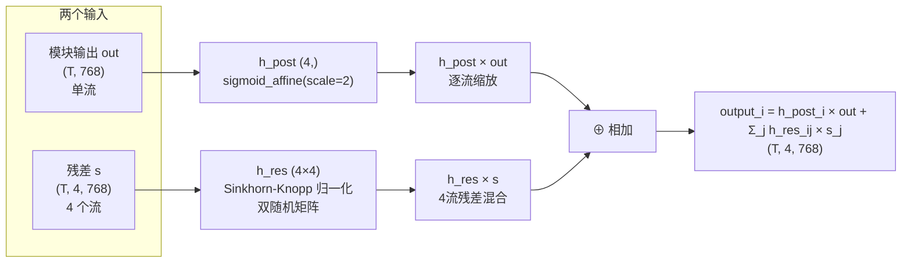

即模块输出经 `h_post` 缩放后与 4 流残差经 `h_res` 混合的结果相加。Triton kernel `_hyper_connect_fwd_kernel` 融合实现。

**前向流程**（`TransformerLayer.forward`，`magi2_preview.py:3017-3042`）：
```
s = hidden.reshape(T, 4, hidden/4)
h_post_attn, h_res_attn, attn_in = MHC_pre_attn(s)    # 算门控 + h_pre 融合成单流
attn_out = Attention(attn_in)
s_, _, mlp_in = MHC_attn→mlp(s, attn_out)             # h_post+h_res 混合 + 再算 mlp 门控
mlp_out = MLP/MoE(mlp_in)
s = MHC_post_mlp(s_, mlp_out)                          # 最终混合
return s.reshape(T, hidden)
```

参数：`mhc_phi_fused_attn/mlp`（shape `hidden*4, 4+4+16=24`）一次投影出 h_pre/h_post/h_res；`alpha_init=0.01` 让训练初期接近恒等。

### 2.6 MoE FFN (MagiMoE) —— 重点组件

MoE 仅用于 preview 阶段的第 2~37 层（共 36 层），配置见 `magi2_preview.json:40-88`：

| 参数 | 值 | 说明 |
| --- | --- | --- |
| num_experts | 256 | 每个 head 的专家数 |
| num_heads | 12 | 多头 MoE 的头数 |
| top_k | 6 | 每个 head 每 token 选 6 个专家 |
| score_func | sigmoid | 路由打分函数 |
| route_norm | true | top-k 概率 L1 归一化 |
| route_scale | 4.9 | 路由概率缩放因子 |
| expert_intermediate_size | 1280 | 每个专家中间维 |
| shared_expert_intermediate_size | 1280 | 共享专家（模态无关）中间维 |
| modality_specific_expert_intermediate_size | 1280 | 模态特定共享专家中间维 |

**展开规模**：`flatten_num_experts = num_heads * num_experts = 12 * 256 = 3072` 个扁平化专家（`magi2_preview.py:2508`）。每 token 激活 = 12 heads × 6 top_k = 72 个专家 × 1280 维 ≈ 92K 参数 + 共享专家，单 token MoE 激活约 6B 量级由此而来。

#### 2.6.1 MultiHeadMoELayer 结构（`magi2_preview.py:2699-2806`）

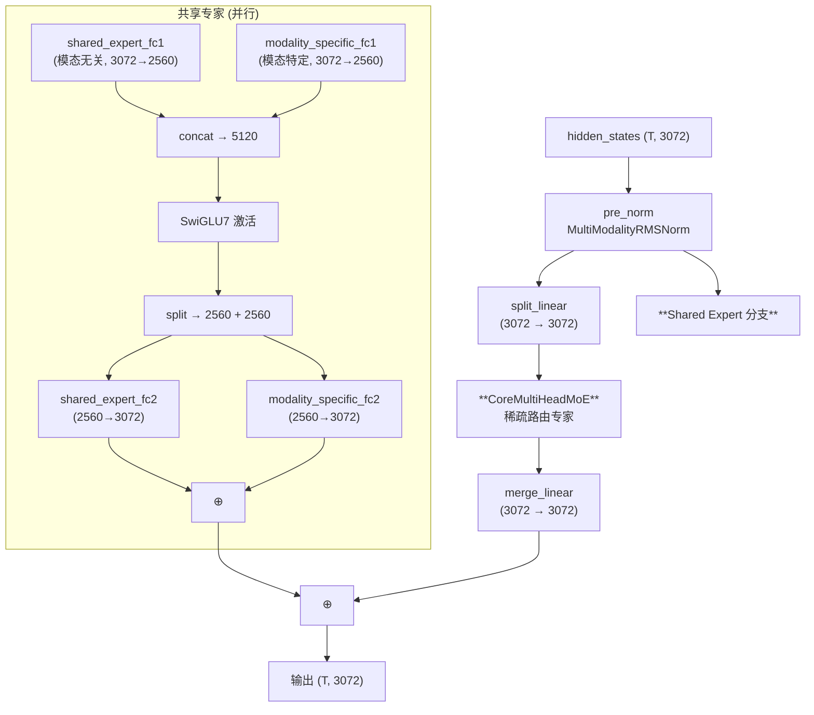

```
norm_output = pre_norm(hidden)
moe_input = split_linear(norm_output)        # hidden→hidden 投影
moe_out = CoreMultiHeadMoE(moe_input)        # 稀疏路由专家
moe_out = merge_linear(moe_out)              # hidden→hidden 投影
shared_out = shared_expert_forward(norm_output)  # 共享专家并行
return moe_out + shared_out
```

**共享专家**（`magi2_preview.py:2775-2795`）分两部分：
- `shared_expert_fc1/fc2`：模态无关（`num_modality=1`），所有 token 共享
- `modality_specific_shared_expert_fc1/fc2`：模态特定（`num_modality=3`），按模态分发
两者 fc1 拼接后过 SwiGLU7，再拆开分别 fc2 投影相加。

#### 2.6.2 CoreMultiHeadMoE 路由与计算（`magi2_preview.py:2495-2655`）

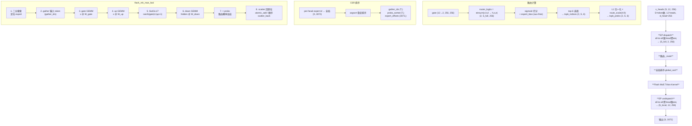

**路由**（`_route`，`magi2_preview.py:2588-2601`）：
1. 输入 `x_heads` shape `(S, 12, 256)`（S=token 数, 12 heads, d_head=256）
2. `gate` shape `(12, 256, 256)`，`router_logits = einsum("shd,hed->hse", x, gate)` → `(12, S, 256)`
3. `compute_topk_probs_and_indices`（`flash_mh_moe/route.py:157-199`）：
   - sigmoid 打分 → 加 expert_bias（aux-free）→ top-6 → L1 归一化 → ×route_scale(4.9)
4. 输出 `topk_probs (12, S, 6)`, `topk_indices (12, S, 6)`

**全局排序**（`flash_mh_moe_global_sort`，`flash_mh_moe/route.py:209-253`）：
- 把 per-head expert id 映射到全局 `[0, H*E)` = `[0, 3072)`
- argsort 排序成 CSR 格式：`gather_ids (T,)`, `probs_sorted (T,)`, `expert_offsets (3073,)`
- T = 12 × S × 6（所有 token×head 的路由分配总数）

**Flash MoE 前向**（`flash_mh_moe/triton/mh_moe_fwd.py:50-182`）：
Triton kernel 实现 `gather → gate/up GEMM → SwiGLU7 → down GEMM → scatter`：
1. 每个 tile 用二分搜索定位所属 expert（`_binary_search_expert_id`）
2. 用 `gather_ids` gather 输入 token
3. 分块 GEMM：`gate_acc = x @ W_gate`, `up_acc = x @ W_up`（循环 d_head, d_expert 分块）
4. SwiGLU7 激活（`swish(clamp(gate)) * (clamp(up)+1)`，alpha=1.702，limit=7.0）
5. `y_acc = hidden @ W_down`
6. 乘以路由概率 `probs`
7. Scatter 回原位：默认 `atomic_add`，确定性模式用顺序 `scatter_back`（`mh_moe_fwd.py:189-215`）

**确定性模式**（`MAGI2_DETERMINISTIC=1`）：kernel 写 flat buffer，host 端 `scatter_add_` 顺序归并，保证 bit-exact 复现（`fwd.py:12-13`，`mh_moe_fwd.py:161-181`）。

**SwiGLU7 激活**（`magi2_preview.py:86-98`）：GPT-OSS 变体，`swish(clamp(x_glu, max=7)) * (clamp(x_linear, [-7,7]) + 1)`，alpha=1.702。

#### 2.6.3 MoE 权重参数

每个 `CoreMultiHeadMoE` 持有（`magi2_preview.py:2542-2579`）：
- `gate`: `(local_flatten_experts, 256)` float32 — 路由门
- `W_gate`: `(local_flatten_experts, 256, 1280)` bf16 — gate 投影
- `W_up`: `(local_flatten_experts, 256, 1280)` bf16 — up 投影
- `W_down`: `(local_flatten_experts, 1280, 256)` bf16 — down 投影
- `router.expert_bias` / `expert_bias_ema`: `(local_flatten_experts,)` float32 — aux-free 偏置

其中 `local_flatten_experts = local_num_heads * num_experts`，随 EP 分片变化（见下文）。

### 2.7 Refiner MLP（稠密）

Refiner 不用 MoE，全部用稠密 SwiGLU7 MLP（`magi2_refiner.py:1781-1849`）：
- `intermediate_size = hidden * 4 * 2/3 = 4096 * 4 * 2/3 ≈ 10920`（对齐到 4 的倍数）
- `up_gate_proj`（2× intermediate）+ SwiGLU7 + `down_proj`
- 三模态层用 `NativeMoELinear`（按模态分组的线性层，非真正 MoE）

### 2.8 输出解码（PostAdapter）

**PostAdapter**（`magi2_preview.py:2879-2912`）：
- `final_norm_video/audio`: 多模态 RMSNorm
- `final_linear_video`: `Linear(hidden*4, 48)` → 视频通道
- `final_linear_audio`: `Linear(hidden*4, 64)` → 音频通道
- 按 video_idx/audio_idx 索引写回，输出 `(T, max(48,64))`

**反打包**（`preview_data_proxy.py:707-713`）：`depack_token_sequence` 把 token 序列还原成 `(B, C, T, H, W)` 视频速度和 `(B, L, C)` 音频速度。

### 2.9 位置编码

`ElementWiseFourierEmbed`（`magi2_preview.py:701-783`）：
- 基于 `freq_bands(dim//8, temperature=10000)` 的逆频率模式
- 输入 coords `(L, 9)`，输出 `(L, head_dim)` 的 sin/cos 拼接
- 支持参考形状缩放（`ref_feat_shape`）用于不同分辨率插值
- 空间维度居中对齐（H/2, W/2 → 0），时间不居中

RoPE 应用：`apply_rotary_emb_torch`（`magi2_preview.py:1138-1157`），非 interleaved 模式，前 `ro_dim` 维旋转。

---

## 三、推理流程详解

### 3.1 推理部署形态

**硬件需求**（`README.md:31-36`）：
- 8 张 NVIDIA Hopper GPU（H100/H200）
- Python 3.12 + CUDA toolkit
- ffmpeg 用于音频 mux

**启动方式**（`scripts/run_demo.sh`）：
```bash
torchrun --nnodes=1 --nproc_per_node=8 --rdzv-backend=c10d \
    --rdzv-endpoint="localhost:29500" \
    inference/pipeline/entry.py \
    --resolution 1080p --seconds 10 --seed 42 \
    --samples assets/demo_samples.json --output output/demo
```

环境变量优化（`run_demo.sh:17-19`）：
- `PYTORCH_CUDA_ALLOC_CONF=expandable_segments:True`
- `NCCL_ALGO=^NVLS`（禁用 NVLS 算法，避免 Hopper 上的已知问题）
- `OMP_NUM_THREADS=64`

**分辨率预设**（`entry.py:30-34`）：
| 预设 | 配置文件 | preview 尺寸 | refiner 尺寸 |
| --- | --- | --- | --- |
| 272p | magi2_preview.json | 448×256 | — |
| 540p | magi2_preview.json | 896×512 | — |
| 1080p | magi2_refiner.json | 896×512 | 1920×1088 |

### 3.2 并行策略

#### 3.2.1 并行配置

```json
"engine_config": {
    "cp_size": 8,
    "ep_size": 8,
    "cp_strategy": "cp_ulysses"
}
```
来源：`magi2_preview.json:2-9`。

**三种并行轴**（`infra/distributed/psm.py:15-29` 注释）：
- **Context Parallel (CP)**: 把一个样本的 token 序列切分到多个 rank
- **Data Parallel (DP)**: 不同样本分给不同 rank
- **Expert Parallel (EP)**: MoE 专家分片到不同 rank

**进程组划分**（`psm.py:44-82`）：
- `cp_size=8, world_size=8` → `dp_size = 8/8 = 1`（无数据并行，单样本）
- CP 组：连续块 `[0,1,2,3,4,5,6,7]`（全部 8 rank）
- DP 组：跨块 stride（这里只有一组）
- EP 组：`ep_size=8` → 一组 `[0..7]`（全部 8 rank）

> **关键：CP 组 == EP 组 == 全部 8 rank**。同一组 rank 同时承担 CP 和 EP 两种角色。

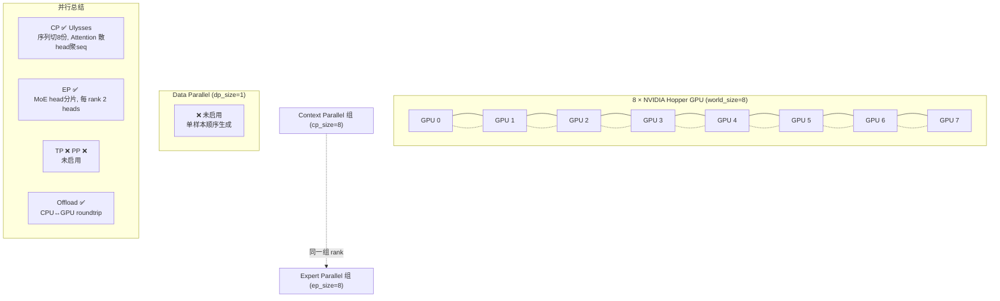

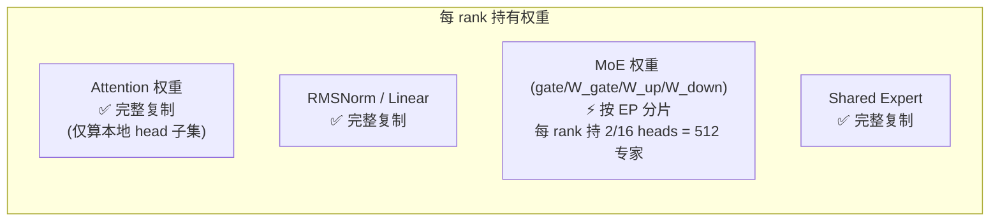

#### 3.2.2 用卡数量与开启的并行

| 项目 | 值 |
| --- | --- |
| GPU 数量 | **8 张 Hopper** |
| CP (Context Parallel) | ✅ cp_size=8，Ulysses 策略 |
| EP (Expert Parallel) | ✅ ep_size=8 |
| DP (Data Parallel) | ❌ dp_size=1（单样本顺序生成） |
| TP (Tensor Parallel) | ❌ 未启用（无 TP group） |
| PP (Pipeline Parallel) | ❌ 未启用 |
| Offload | ✅ CPU↔GPU roundtrip offload |

#### 3.2.3 Context Parallel (Ulysses) 详解

**Ulysses 调度器**（`infra/parallelism/context_parallel/ulysses_scheduler.py`）：
- `dispatch(x)`: 沿 dim 0 切分序列，每个 rank 保留 `S/8` 的切片（`ulysses_scheduler.py:48-82`）
- 切分大小 `cp_split_sizes` 记录下来，供 Attention 的 all-to-all 使用
- `undispatch(x)`: `all_gather` + concat 还原完整序列

**Transformer 入口**（`magi2_preview.py:3206-3248`）：
```python
x = ulysses_scheduler().dispatch(x)           # 序列切分到各 rank
coords_mapping = ulysses_scheduler().dispatch(coords_mapping)
modality_mapping = ulysses_scheduler().dispatch(modality_mapping)
# ... 整个 TransformerBlock 在 S/8 token 上运行 ...
x_out = ulysses_scheduler().undispatch(x_out) # 最后 gather 回完整序列
```

**Attention 内部的 Ulysses**（`magi2_preview.py:2173-2229`）：

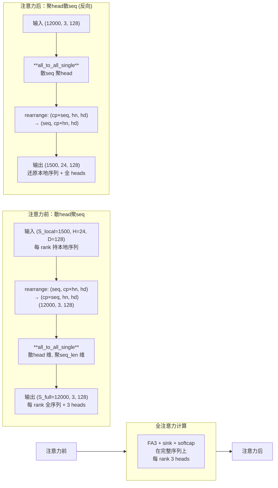

1. 注意力前：`batch_scatter_head_gather_seqlen` all-to-all，`(S_local, H_all, D)` → `(S_full, H_local, D)`
   - 散 head 维、聚 seq_len 维（`all_to_all_primitive.py:90-141`）
   - 每个 rank 拿到完整序列但只有 `H/8` 个 head
2. 在完整序列、本地 head 上跑 FA3（全注意力，无信息丢失）
3. 注意力后：`scatter_seqlen_gather_head` 反向 all-to-all 还原

> preview: Q heads=24, CP=8 → 每 rank 3 heads 做全注意力
> refiner: Q heads=32, CP=8 → 每 rank 4 heads 做全注意力

#### 3.2.4 EP 对 Attention 和非 MoE 部分的影响

由于 EP 组和 CP 组是同一组 rank，且非 MoE 权重是**复制**（replicated）的：
- Attention 权重：每个 rank 持有完整权重，但只算本地 head 子集（由 Ulysses 保证）
- RMSNorm、线性层：完整权重，在 S/8 本地 token 上计算
- **只有 MoE 权重按 EP 分片**

### 3.3 MoE 并行策略 —— 重点分析

#### 3.3.1 EP 权重分片

**加载时分片**（`infra/checkpoint/magi2_checkpointing.py`）：

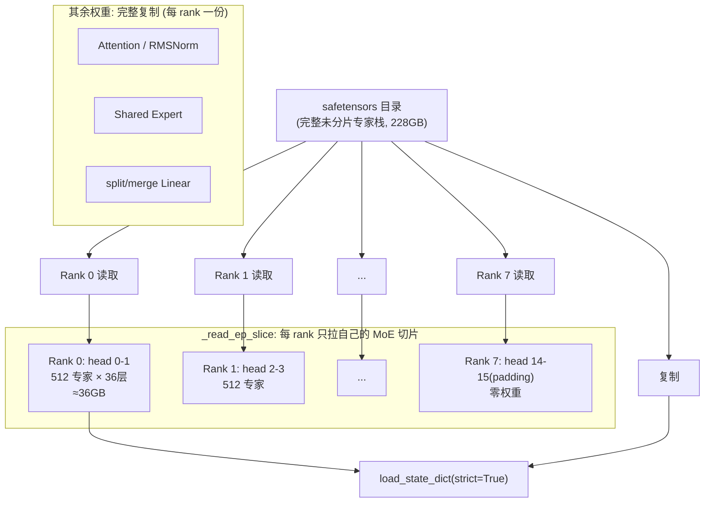

- 权重以**未分片的完整专家栈**形式存储在一个 safetensors 目录（`magi2_checkpointing.py:15-21` 注释）
- 每个 EP rank 读同一目录，但只拉取自己拥有的 MoE 张量切片（`_read_ep_slice`，`magi2_checkpointing.py:81-105`）
- 分片后缀：`moe_mlp.gate / W_gate / W_up / W_down / router.expert_bias / expert_expert_ema`（`magi2_checkpointing.py:43-50`）
- 其余权重（Attention、RMSNorm、shared expert、split/merge linear）**全部复制**

**Head padding**（`magi2_preview.py:2514-2538`）：
- `num_heads=12`, `ep_size=8`：12 不能被 8 整除
- `padded_num_heads = ceil(12/8) * 8 = 16`，`ep_pad_heads = 4`
- `local_num_heads = 16 / 8 = 2`（每个 EP rank 持有 2 个 head 的专家）
- `local_flatten_num_experts = 2 * 256 = 512`
- 超出真实 head 范围的 rank（`has_real_moe_heads=False`）持有零权重，参与 all-to-all 但输出被丢弃

**每 rank MoE 权重内存**：
- W_gate + W_up + W_down: `512 × (256×1280 + 256×1280 + 1280×256) × 2 bytes(bf16) = 512 × 3 × 327680 × 2 ≈ 1.0 GB/层`
- gate: `512 × 256 × 4 bytes(float32) ≈ 0.5 MB/层`
- 36 个 MoE 层 → 约 **36 GB/rank** 仅 MoE 权重
- preview 总 228 GB / 8 rank ≈ 28.5 GB/rank（含非 MoE 复制权重），加上 shared expert 等，单 rank 约 30+ GB，80GB Hopper 可容纳（配合 roundtrip offload）

#### 3.3.2 EP Dispatch / Undispatch（运行时）

**ep_dispatch**（`magi2_preview.py:3277-3299`）：
```
输入: (S, H=16_padded, D=256)    # S 是 CP 后的本地序列长度
  → view (S, ep=8, H/ep=2, D)
  → permute(1,0,2,3) → (8, S, 2, D) contiguous
  → all_to_all_single → 每个 rank 发送 S tokens 给 8 个 rank，接收 S×8 tokens
输出: (S*8, 2, D)                # 全部 token，本地 2 heads
```

**ep_undispatch**（`magi2_preview.py:3303-3327`）：反向 all-to-all 还原 `(S*8, 2, D) → (S, 16, D)`。

**结合 CP 的完整数据流**（cp=ep=8，同一组 rank）：

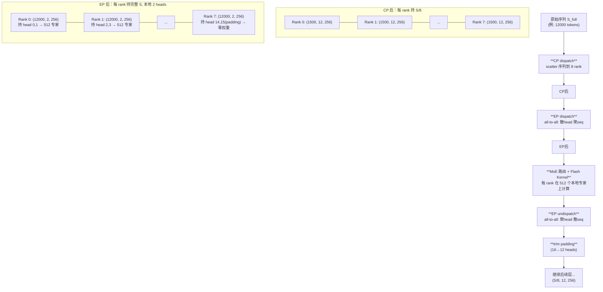

```
原始序列 S_full
   │ CP dispatch (scatter seq)
   ▼
每个 rank: (S_full/8, 12, 256)     ← 序列并行，所有 head
   │ EP dispatch (all-to-all: scatter head, gather seq)
   ▼
每个 rank: (S_full, 2, 256)        ← 完整序列，本地 2 heads
   │ MoE routing + flash kernel (在 512 个本地专家上)
   ▼
每个 rank: (S_full, 2, 256)        ← MoE 输出
   │ EP undispatch (all-to-all: gather head, scatter seq)
   ▼
每个 rank: (S_full/8, 16, 256) → trim pad → (S_full/8, 12, 256)
   │ 继续后续层...
```

> **核心洞察**：CP 先把序列切成 8 份（每 rank S/8），EP 再通过 all-to-all 把序列拼回完整（每 rank S），同时把 head 切成 1/8（每 rank 2 heads）。这样每个 rank 在 MoE 计算时处理完整序列但只负责自己的 head 子集和对应的 512 个专家。CP 和 EP 共享同一组 rank，all-to-all 在组内完成。

#### 3.3.3 EP/CP 对齐填充

`preview_data_proxy.py:478-584` 的 `_pad_for_ep_cp`：
- 用 `all_reduce(MAX)` 跨 EP 和 CP 组同步 token 数
- 对齐到 48 的倍数（`align_to=48`），不足的补 TEXT 模态 padding token
- 保证所有 rank 的 token 数一致，避免 all-to_all 死锁

#### 3.3.4 路由偏置 EMA

`magi2_checkpointing.py:132-157`：推理使用 `expert_bias_ema`（EMA 平滑值）替代 `expert_bias`（原始训练值），以匹配 EMA 模型权重。可用 `MAGI2_ROUTER_BIAS_SOURCE=main` 覆盖。

---

## 四、端到端视频生成示例

以 `assets/demo_samples.json` 中第一条 I2V 样本为例：
```json
{"prompt_file": "assets/sample_000.txt", "image": "assets/sample_000.jpeg"}
```
目标：1080p（1920×1088）、10 秒、seed=42。

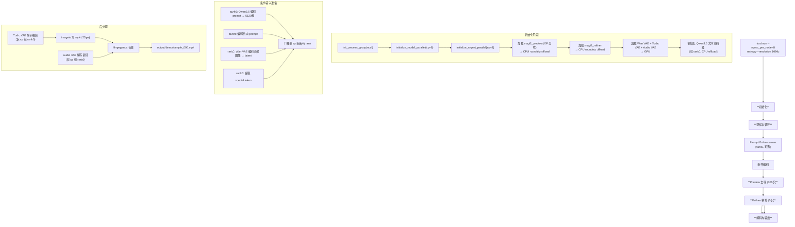

### 4.1 启动与初始化

1. **`entry.py:main()`**（`entry.py:149-193`）：
   - 解析参数，加载 `configs/magi2_refiner.json`（extends `magi2_preview.json`，`magi2_config.py:376-391` 的 `_read_config_json` 递归合并）
   - `_init_distributed`：`init_process_group(nccl)` → `initialize_model_parallel(cp_size=8)` → `initialize_expert_parallel(ep_size=8)`（`entry.py:108-122`）
   - 构建 `Magi2Pipeline(config)` → 加载 preview 和 refiner 模型

2. **模型加载**（`pipeline/pipeline.py:37-57` → `infra/checkpoint/load_checkpoint.py:29-58`）：
   - `Transformer(arch, ep_size=8)` 构建模型结构（含 EP padding）
   - `load_magi2_model_state_dict`：每个 rank 读 safetensors，MoE 张量只读自己的 EP 切片（`_read_ep_slice`）
   - `model.to(cuda).eval()`
   - `OffloadUtils.setup(model, ROUNDTRIP, device)`：preview 模型存 CPU，保留 GPU 指针备份（`offload_utils.py:63-99`）
   - 若 `use_magi2_refiner`，同样加载 refiner（`load_checkpoint.py:61-88`）

3. **推理引擎初始化**（`inference_engine.py:100-228`）：
   - 加载 Wan2.2 VAE、Turbo VAE（仅 cp 组第一个 rank）、Stable Audio VAE
   - 初始化文本编码器 Qwen3.5（仅 cp 组第一个 rank，CPU offload）
   - 构建 `DistBroadcaster`：cp 组内 rank0→其他广播文本/图像特征
   - offload 配置：text_enc=CPU, preview=ROUNDTRIP, refiner=ROUNDTRIP, vae=GPU

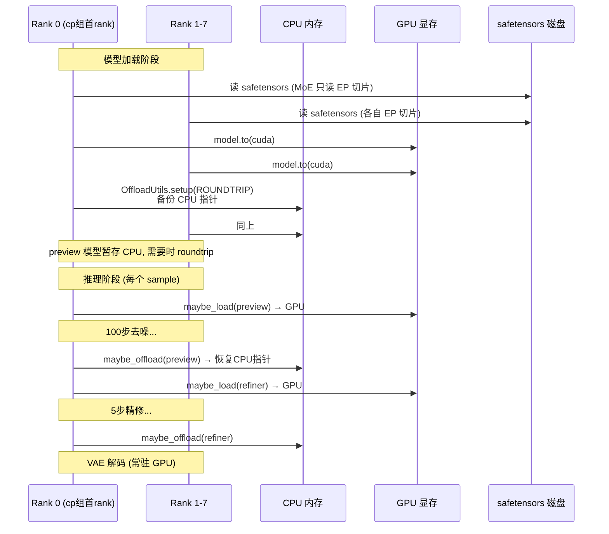

### 4.2 Prompt Enhancement（可选）

`pipeline.py:147-155`：rank0 调 `enhance_prompt(prompt, image_path)`，用 OpenAI 兼容 LLM 把短 prompt 改写成结构化 JSON caption（`inference/prompt_enhancement/enhancer.py`）。结果广播到所有 rank。`API_KEY` 为空则跳过。

### 4.3 Preview 阶段去噪

`inference_engine.py:evaluate`（`inference_engine.py:395-525`）：

**Step 1: 准备条件输入**
- `_encode_images`（`inference_engine.py:339-371`）：rank0 用 Wan VAE 编码首帧图像 → latent，广播给 cp 组
- `get_text_embedding`（`inference_engine.py:238-243`）：rank0 用 Qwen3.5 编码 prompt → 5120 维特征，广播
- `get_null_feature`：编码负向 prompt（`inference_engine.py:40-63` 的超长 DEFAULT_NEGATIVE_PROMPT）
- `get_special_token`：提取 `<Figure 1>` token 的池化嵌入作为图像条件

**Step 2: 初始化噪声 latent**
- `video_frame_length = round(10 * 12.5 * 2) = 250` 帧（`inference_engine.py:230-236`）
- `video_latent_length = (250-1)//8 + 1 = 32`（VAE 时间 stride=8）
- `latent = randn(1, 48, 32, H_lat, W_lat)` — 视频噪声
- `audio_latent = randn(1, 250, 64)` — 音频噪声（25 fps × 10s）
- latent 尺寸：1080p preview 为 896×512 → latent 56×32（512/16）

**Step 3: 设置调度器**
- `FlowUniPCMultistepScheduler`（`sampler.py:456-1262`），shift=7.0，100 步
- 视频/音频各一个 scheduler

**Step 4: 去噪循环**（`sampler.py:60-105`）

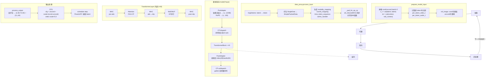

每个时间步 t：
1. `prepare_model_input`（`sampler.py:107-200`）：
   - 拼接 cond/uncond batch=2：`x_t = cat([latent, latent])`, `txt_feat = cat([context, null_context])`
   - 计算逐 token 时间步 `per_token_video_t`, `per_token_audio_t`
   - ref_image 在 cond 半保留、uncond 半置零（`use_ref_for_uncond=false`）
2. `data_proxy.process_input`（`preview_data_proxy.py:601-705`）：
   - `img2tokens`：latent → token 序列
   - 构建 `SingleData` → `SimplePackedData`（打包 cond+uncond）
   - 生成 `modality_mapping`, `coords_mapping`, `time_token_sequence`, `varlen_handler`
   - `_pad_for_ep_cp`：跨 EP/CP 同步并 padding 到 48 倍数
   - 返回 `(token_seq, coords, modality_map, varlen_handler, time_tokens)`
3. **模型前向** `model(*model_input)`（`sampler.py:54-58`）：
   - **PreAdapter**：各模态嵌入 → `output_x (L, 12288)`, `rope (L, 128)`
   - **CP dispatch**：序列切分到 8 rank（每 rank L/8 token）
   - **TransformerBlock** 40 层循环：
     - 每层：MHC-pre-attn → **Attention**（FA3 + Ulysses CP + sink + gating）→ MHC-attn→mlp → **MoE**（EP dispatch → 路由 → flash kernel → EP undispatch）/ **MLP**（首尾稠密层）→ MHC-post-mlp
   - **PostAdapter**：投影回 video/audio 通道
   - **CP undispatch**：gather 回完整序列
4. `data_proxy.process_output`：反打包 → `(2, 48, T, H, W)` 视频 + `(2, L, 64)` 音频
5. **CFG**（`sampler.py:365-433`）：
   - `cfg_video = uncond + scale * (cond - uncond)`，video scale=5.0
   - 支持 cfg_trick（前 13 帧降 scale）、dynamic_cfg、skimmed_cfg、cfg_rescale
6. `scheduler.step`：FlowUniPC 更新 latent

**Step 5: 卸载 preview 模型**（`inference_engine.py:503`）：`OffloadUtils.maybe_offload(model, ROUNDTRIP)` → 恢复 CPU 指针，释放 GPU

### 4.4 Refiner 阶段精修

`inference_engine.py:551-676`：

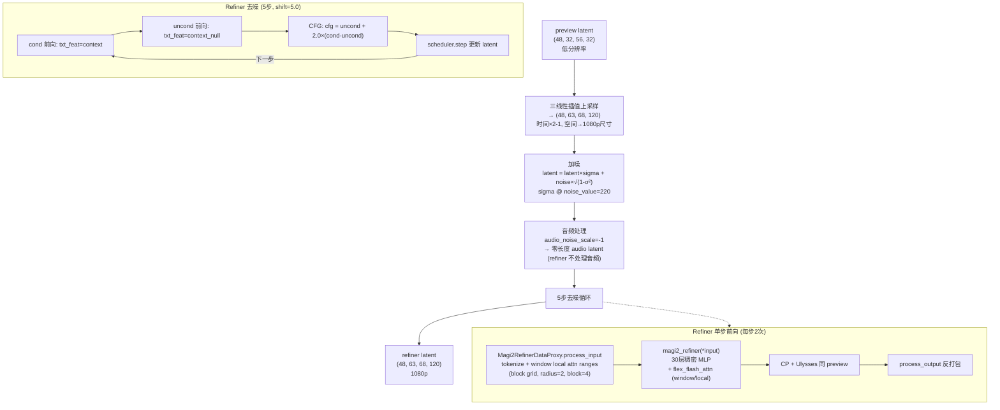

1. **上采样**：`interpolate(latent, size=(T*2-1, H_ref, W_ref), mode="trilinear")` 把 preview latent 从 56×32 放大到 refiner 尺寸（1088/16=68, 1920/16=120）
2. **加噪**（`inference_engine.py:588-592`）：`latent = latent * sigma + noise * sqrt(1-sigma²)`，`noise_value=220` 对应 sigma
3. **音频处理**（`inference_engine.py:594-608`）：`audio_noise_scale=-1` → refiner 不处理音频（零长度 audio latent）
4. **5 步去噪**（`inference_engine.py:637-671`）：FlowUniPC shift=5.0，每步 cond+uncond 两次前向 + CFG（video scale=2.0）
5. Refiner 前向（`inference_engine.py:527-549`）：
   - `Magi2RefinerDataProxy.process_input`：tokenize + 构建 window local attn ranges（block grid, radius=2, block_size=4, `refiner_data_proxy.py:656-796`）
   - `magi2_refiner(*model_input)`：30 层稠密 MLP + local/window attention（`flex_flash_attn_with_cp`）
   - CP + Ulysses 同 preview
6. 卸载 refiner

### 4.5 后处理与输出

`inference_engine.py:717-747` → `pipeline.py:169-182`：

1. **视频解码**（`inference_engine.py:683-715`）：
   - 仅 cp 组第一个 rank 执行（`psm.is_group_first_rank("cp")`）
   - 默认用 Turbo VAE（蒸馏解码器，`turbo_vaed.py`）滑动窗口解码
   - 输出 `(T, H, W, 3)` uint8
2. **音频解码**（`inference_engine.py:678-681`）：Stable Audio VAE decode + sinc 重采样（441/512）
3. **保存**（`pipeline.py:203-241`）：
   - `imageio.mimwrite` 写视频 mp4，fps = 12.5 × 2 = 25（refiner 翻倍）
   - `ffmpeg` 把音频 mux 进 mp4（aac 编码）
4. 输出 `output/demo/sample_000.mp4`

### 4.6 确定性模式

`MAGI2_DETERMINISTIC=1` 或 `--deterministic`（`entry.py:125-146`）：
- `MAGI_ATTENTION_DETERMINISTIC_MODE=1`
- `torch.use_deterministic_algorithms(True)`
- MoE 用顺序 scatter_back（非 atomic_add）
- Inductor 关闭 benchmark_epilogue_fusion、coordinate_descent_tuning 等非确定性 autotuning

---

## 五、关键代码索引

| 组件 | 文件 | 关键行 |
| --- | --- | --- |
| 模型定义 (preview) | `inference/model/magi2_preview.py` | `Transformer:3184`, `TransformerLayer:2915`, `Attention:2326`, `CoreMultiHeadMoE:2495`, `MultiHeadMoELayer:2699`, `MHCHandler:1942`, `PreAdapter:2819`, `PostAdapter:2879` |
| 模型定义 (refiner) | `inference/model/magi2_refiner.py` | `Transformer:2187`, `Attention:1606`, `MLP:1781`, `Adapter:1873` |
| MoE 路由 | `inference/flash_mh_moe/route.py` | `compute_topk:157`, `global_sort:209` |
| MoE Triton kernel | `inference/flash_mh_moe/triton/mh_moe_fwd.py` | `_mh_moe_fwd_kernel:50`, `mh_moe_fwd_func:231` |
| EP dispatch/undispatch | `inference/model/magi2_preview.py` | `ep_dispatch:3277`, `ep_undispatch:3303` |
| Checkpoint EP 分片 | `inference/infra/checkpoint/magi2_checkpointing.py` | `_read_ep_slice:81`, `_EP_SHARDED_SUFFIXES:43` |
| CP Ulysses | `inference/infra/parallelism/context_parallel/ulysses_scheduler.py` | `UlyssesScheduler:27` |
| CP all-to-all | `inference/infra/parallelism/all_to_all_primitive.py` | `batch_scatter_head_gather_seqlen:90`, `scatter_seqlen_gather_head:39` |
| 并行状态管理 | `inference/infra/distributed/psm.py` | `ParallelStateManager:85` |
| 推理引擎 | `inference/pipeline/inference_engine.py` | `evaluate:395`, `evaluate_magi2_refiner_with_latent:551` |
| 采样器 | `inference/pipeline/sampler.py` | `Magi2PreviewSampler:41`, `FlowUniPCMultistepScheduler:456` |
| 数据代理 (preview) | `inference/pipeline/preview_data_proxy.py` | `Magi2DataProxy:461`, `process_input:601` |
| 数据代理 (refiner) | `inference/pipeline/refiner_data_proxy.py` | `Magi2RefinerDataProxy:506`, window attn `:656` |
| Offload | `inference/common/offload_utils.py` | `OffloadUtils:63`, `OffloadMode:32` |
| 配置 | `inference/common/magi2_config.py` | `Magi2Config:336`, `ModelConfig:121`, `MoEConfig:107` |
| 文本编码器 | `inference/model/qwen35.py` | `Qwen35TextEncoder:223` |
| 视频 VAE | `inference/model/vae2_2.py` | `Wan2_2_VAE:875` |
| Turbo VAE | `inference/model/turbo_vaed.py` | `TurboVAED:777` |
| 音频 VAE | `inference/model/sa_audio_vae.py` | `AudioAutoencoder:218` |
| 入口 | `inference/pipeline/entry.py` | `main:149`, `_init_distributed:108` |

---

## 六、总结

MAGI-2 Preview 的核心设计要点：

1. **MagiMoE 稀疏架构**：114B 总参数，12 head × 256 expert = 3072 扁平专家，top-6 路由，单 token 仅激活 ~6B，配合 shared expert 和 modality-specific expert 保证基础能力。

2. **MHC (Multi-Head Connect)**：4 流残差混合 + Sinkhorn-Knopp 归一化路由，让 Attention 和 MLP/MoE 的信息流可在多流间动态混合，是区别于标准残差连接的关键结构创新。

3. **CP + EP 双重并行**：8 卡 Hopper，cp=ep=8 共享同一组 rank。CP (Ulysses) 通过 all-to-all 在 Attention 中实现序列并行（散 head 聚 seq）；EP 在 MoE 中散 head 分片专家权重。两者嵌套使用，无 TP/DP/PP。

4. **两阶段生成**：preview 100 步低分辨率去噪 + refiner 5 步超分精修，配合 roundtrip CPU offload 在 80GB 卡上分时复用。

5. **工程优化**：Triton fused MoE kernel（gather-GEMM-SwiGLU-GEMM-scatter）、FA3 + attention sink、MagiCompiler 子图编译、确定性模式、Turbo VAE 蒸馏解码器。

6. **统一多模态**：视频、音频、文本 token 拼接统一过 DiT，三模态层（首尾）用模态特定 RMSNorm/Linear，MoE 层全程三模态，输出按模态拆解，端到端生成带声视频。

---

## 九、SP4 部署下的端到端推理全流程总结

> 本节串联前文所有关键技术点，给出 MAGI-2 Preview 在 SP=4（TP=1, CFG=1 batch 打包）部署形态下的完整推理流程。

### 9.1 部署配置

```
硬件: 4 × GPU (如 L20X 140GiB)
并行: TP=1, SP=4 (Ulysses), CFG=1 (batch 打包), DP=1
分辨率: 540p (896×512), 100 步去噪, 10 秒视频
权重: Transformer 常驻 HBM（不 offload）
```

### 9.2 权重分布全景

```
模型总参数: ~114B (bf16 → ~228 GB)
SP=4 每卡权重:

┌─────────────────────────────────────────────────────────────┐
│ MoE 路由专家权重 (SP 按 head 分片)                           │
│   gate:        (768, 256)         ← 12 head / 4 = 3 head    │
│   W_gate:      (768, 256, 1280)   ← 3 head × 256 expert     │
│   W_up:        (768, 256, 1280)   ← 每卡不同（分片）         │
│   W_down:      (768, 1280, 256)                              │
│   expert_bias: (768,)                                        │
│   大小: ~54.2 GB/卡  ← 占 87%                                │
│   切分方式: 按 MoE head 维度，复用 SP 组                     │
│   通信: ep_dispatch/ep_undispatch (All-to-All)              │
├─────────────────────────────────────────────────────────────┤
│ 复制权重（每卡完整相同）                                      │
│   Attention QKV/proj/gating:  ~3.0 GB   ← 全 24 head 权重   │
│   Attention sinks/q_norm/k_norm: ~0.1 GB                    │
│   Dense MLP (layer 0,1,38,39): ~0.6 GB                      │
│   Shared expert fc1/fc2:      ~0.05 GB ← 模态无关 + 模态特定 │
│   split_linear/merge_linear:  ~0.04 GB                      │
│   MHC phi/bias/alpha/norm:    ~0.05 GB                      │
│   PreAdapter/PostAdapter:     ~0.13 GB                      │
│   All RMSNorm:                ~0.01 GB                      │
│   大小: ~4.0 GB/卡   ← 占 6%                                │
│   切分方式: 不切分，每卡完整复制                              │
│   通信: 无（直接在本地 S/4 token 上计算）                    │
├─────────────────────────────────────────────────────────────┤
│ 每卡权重合计: ~58.2 GB                                       │
│ 激活+workspace: ~5-10 GB                                     │
│ 峰值 HBM: ~65 GB  << 140 GB (余量充足)                       │
└─────────────────────────────────────────────────────────────┘
```

**为什么 Attention 权重复制而不切分？**
因为 SP 的 Ulysses all-to-all 在 QKV 投影之后做（散 head 聚 seq），需要先用完整权重算出全部 24 head 的 QKV 值，才能按 head 分发。如果先 AllGather 原始 hidden（3072 维）再投影，通信量是后投影方案的 4 倍（3072 vs 768/head 组）。复制 1.3% 的 Attention 权重换取 4× 通信节省（详见第 9.7 节）。

### 9.3 数据切分

```
总 token 序列 S ≈ 58,000 (540p):
  video: 32×32×56 = 57,344 tokens (VAE latent patchify)
  audio: 250 tokens
  text: ~500 tokens (Qwen3.5 编码)
  
CFG batch=2: S_total ≈ 116,000 (cond + uncond 拼接)

SP=4 切分:
  每 rank: S_total/4 ≈ 29,000 tokens
  cond 段: ~14,500 tokens (varlen cu_seqlens 隔离)
  uncond 段: ~14,500 tokens
```

### 9.4 端到端推理流程（一个去噪步）

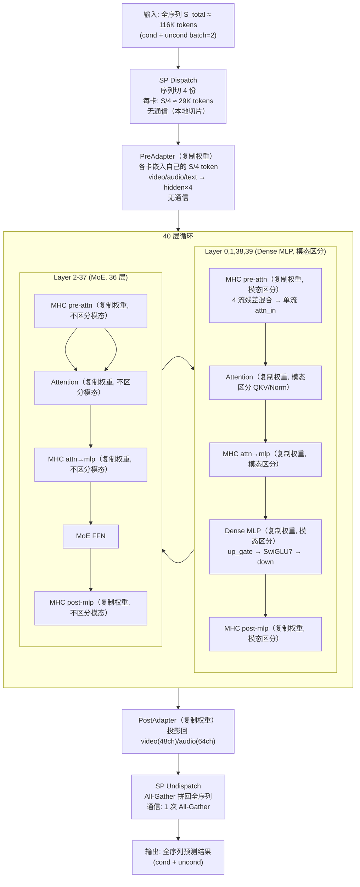

### 9.5 一层 MoE 的详细计算流程（Layer 2-37）

以 SP=4, batch=2, 540p 为例，每卡 S/4 ≈ 29K tokens：

```mermaid
flowchart TB
    INPUT["hidden_states<br/>(29K, 3072) 本地 S/4 token"]

    INPUT --> MHC_PRE["MHC pre-attn（复制权重, 位置无关）<br/>4 流 → phi 投影 → sigmoid 门控<br/>→ Sinkhorn-Knopp 残差混合<br/>→ 单流 attn_in (29K, 3072)<br/>通信: 无"]

    MHC_PRE --> ATT_ENTRY["进入 Attention"]

    subgraph ATT["Attention（复制权重 + SP All-to-All）"]

        A1["pre_norm (复制, 不区分模态)<br/>(29K, 3072)"]
        A1 --> A2["QKV 投影 (复制权重, 全 24 head)<br/>→ q,k,v 各 (29K, 24, 128)"]
        A2 --> A3["Q/K norm (复制权重)"]
        A3 --> A4["inv_permute 还原原始顺序"]
        A4 --> A5["RoPE (按 token 坐标)"]
        A5 --> A6["SP All-to-All: 散head聚seq<br/>(29K, 24, 128) → (116K, 6, 128)<br/>通信: All-to-All ← Attention 需要"]
        A6 --> A7["FA3 全双向注意力<br/>(116K, 6, 128)<br/>varlen: cond/uncond 隔离<br/>sink token + gating"]
        A7 --> A8["SP All-to-All: 聚head散seq<br/>(116K, 6, 128) → (29K, 24, 128)<br/>通信: All-to-All ← 还原"]
        A8 --> A9["permute 重排按模态"]
        A9 --> A10["sigmoid(g) 门控"]
        A10 --> A11["output proj (复制权重)<br/>→ (29K, 3072)"]
    end

    ATT --> MHC_MID["MHC attn→mlp（复制权重, 位置无关）<br/>h_post 缩放 + h_res Sinkhorn 混合<br/>→ mlp_in (29K, 3072)<br/>通信: 无"]

    MHC_MID --> MOE_ENTRY["进入 MoE FFN"]

    subgraph MOE["MoE FFN（三路并行计算, 顺序执行）"]

        MN["pre_norm (复制, 模态区分 num_modality=3)<br/>(29K, 3072)"]

        MN -->|"split_linear 复制权重"| MOE_INPUT["moe_input (29K, 3072)"]
        MN -->|"直接输入"| SHARED_INPUT["norm_output (29K, 3072)"]

        MOE_INPUT --> MOE_VIEW["view → (29K, 12, 256)<br/>pad → (29K, 16, 256)"]

        MOE_VIEW --> EP_DISPATCH["ep_dispatch: SP All-to-All<br/>(29K, 16, 256) → (116K, 4, 256)<br/>全序列, 4 local head (3 real + 1 pad)<br/>通信: All-to-All ← MoE 权重分片需要"]

        EP_DISPATCH --> ROUTE["路由: 每 head top-6/256<br/>sigmoid + bias + norm + scale×4.9<br/>→ 18 expert activations/token<br/>通信: 无（本地路由）"]

        ROUTE --> SORT["全局排序: argsort → CSR<br/>gather_ids + expert_offsets<br/>通信: 无"]

        SORT --> KERNEL["Flash MoE Triton Kernel<br/>gather → gate GEMM → up GEMM<br/>→ SwiGLU7 → down GEMM → scatter<br/>权重: SP 分片 (768 local experts)<br/>通信: 无（本地 GEMM）"]

        KERNEL --> EP_UNDISPATCH["ep_undispatch: SP All-to-All<br/>(116K, 4, 256) → (29K, 16, 256)<br/>trim pad → (29K, 12, 256) → (29K, 3072)<br/>通信: All-to-All ← 还原"]

        EP_UNDISPATCH --> MERGE["merge_linear (复制权重)<br/>→ moe_out (29K, 3072)"]

        SHARED_INPUT --> SHARED["共享专家（复制权重, 位置无关）"]
        subgraph SHARED["共享专家 — 零通信"]

            S1["shared_fc1 (1组权重, 不区分模态)<br/>(29K, 3072) → (29K, 2560)"]
            S2["modality_fc1 (3组权重, 区分模态)<br/>video→video权重, audio→audio, text→text<br/>(29K, 3072) → (29K, 2560)"]
            S1 --> S3["concat → (29K, 5120)"]
            S2 --> S3
            S3 --> S4["SwiGLU7 → split"]
            S4 --> S5["shared_fc2 → (29K, 3072)"]
            S4 --> S6["modality_fc2 → (29K, 3072)"]
            S5 --> S7["x1 + x2 → shared_out (29K, 3072)"]
            S6 --> S7
        end

        MERGE --> ADD["moe_out + shared_out<br/>→ (29K, 3072)<br/>本地相加, 无通信"]
        SHARED --> ADD
    end

    MOE --> MHC_POST["MHC post-mlp（复制权重, 位置无关）<br/>h_post + h_res 混合 → 最终 4 流<br/>→ reshape (29K, 3072)<br/>通信: 无"]

    MHC_POST --> OUTPUT["输出: (29K, 3072) 本地 S/4 结果"]
```

### 9.6 每层通信统计

| 通信 # | 位置 | 类型 | 数据量 | 原因 |
| --- | --- | --- | --- | --- |
| ① | Attention 前 | All-to-All | 3 × 29K × 6 × 128 | 散 head 聚 seq：让每卡看到全序列算 6 head 注意力 |
| ② | Attention 后 | All-to-All | 29K × 6 × 128 | 聚 head 散 seq：还原为本地 S/4 全 24 head |
| ③ | MoE ep_dispatch | All-to-All | 29K × 4 × 256 | 散 head 聚 seq：让每卡在完整序列上算 3 head MoE |
| ④ | MoE ep_undispatch | All-to-All | 116K × 4 × 256 | 聚 head 散 seq：还原为本地 S/4 全 12 head |

**每层 4 次 All-to-All，全部是等量通信（固定模式，不依赖路由）。** 40 层共 160 次 All-to-All。

**零通信的操作**（位置无关 + 权重复制）：
- RMSNorm / MultiModalityRMSNorm
- QKV 投影 / output 投影 / gating
- Q/K norm
- RoPE
- MHC（phi 投影 / sigmoid / Sinkhorn / hyper_connect）
- split_linear / merge_linear
- 共享专家（shared fc1/fc2 + modality fc1/fc2 + SwiGLU7）
- Dense MLP（layer 0,1,38,39）
- PreAdapter / PostAdapter

### 9.7 关键技术点串联

**① 为什么 SP 先投影再 All-to-All（而不是先 All-to-All 再投影）？**

QKV 投影把 3072 维 hidden 展开成 24×128 的 head 结构。投影后通信量 = 29K × 6 × 128 = 22.5M 元素/head 组。如果先 AllGather hidden 再投影，通信量 = 29K × 3072 = 89M 元素。**先投影再通信，通信量减少 4 倍**（3072 vs 768/head 组）。

代价：Attention 权重复制（每卡全 24 head），但只占模型 1.3%，微不足道。

**② 为什么 MoE 路由专家需要 ep_dispatch 但共享专家不需要？**

路由专家权重按 head 分片（每卡 3 head），token 需要全部 12 head → 必须 all-to-all 把 token 发给持有对应 head 权重的卡。共享专家权重复制（每卡完整），token 直接在本地算 → 零通信。

**③ 为什么 Ulysses all-to-all 是等量的？**

SP 把序列按位置切分（rank 0 拿 token 0~S/4），每卡的 token 数固定。All-to-All 交换的是 head 组（固定 6 个/head 组），不依赖路由结果。对比传统 EP 的变长 all-to-all（依赖路由，负载不均），Ulysses 的等量通信更高效、可预测。

**④ 为什么 Attention 不区分模态但 QKV 投影区分？**

QKV 投影的任务是把不同模态的特征"翻译"到统一的注意力空间（不同模态需要不同投影矩阵）。Attention 计算的任务是让不同模态的 token 在统一空间内自由交互（跨模态注意力）。如果 Attention 也按模态区分，video 就无法 attend text，跨模态信息流被切断。

中间 36 层（Layer 2-37）的 Attention 权重不区分模态（num_modality=1），因为跨模态交互是这些层的核心任务。模态区分由 MoE 的 modality-specific shared expert 承担。首尾 4 层（Layer 0,1,38,39）的 Attention 区分模态，用于入口/出口的模态适配。

**⑤ 为什么共享专家不并行计算？**

路由专家是计算 bound（每 expert ~2719 token, AI=872 >> 平衡点），GPU 算力已打满，共享专家无法"见缝插针"。且共享专家只占路由专家 26% 的 FLOPs，并行收益有限（~7-11%）。传统 EP 的共享专家多流并行有收益，是因为传统 EP 访存 bound（expert 不均衡 + 变长通信），GPU 有空闲算力可填补。

**⑥ 为什么 SP-only 不切 Attention 权重而要复制？**

切 Attention 权重需要先 AllGather hidden（3072 维全量）再投影，通信量 4× 于先投影再 all-to-all（768 维/head 组）。且 Attention 权重只占模型 1.3%，复制的浪费（2.26 GB）远小于额外通信的代价。如果需要切 Attention 权重，用 TP+SP 组合（TP 切权重 + SP 切序列）。

**⑦ CFG batch 打包 vs CFG 并行的选择依据？**

访存 bound（CPU offload）时：权重加载主导，batch=2 把权重加载均摊到 2× token，比 CFG=2（权重加载不减）更高效。

计算 bound（权重常驻 HBM）时：计算主导，CFG=2 把计算减半（batch=1 × 2 组并行），收益接近 2×。

MAGI-2 540p 在 SP4 常驻模式下偏计算 bound（Attention O(S²) 主导），CFG 并行有理论收益。但 SandAI 官方用 CPU roundtrip offload（访存 bound），所以选 batch 打包。

**⑧ 模态区分的分层设计**

| 层 | Attention 权重 | MoE/MLP 权重 | 设计意图 |
| --- | --- | --- | --- |
| Layer 0,1 | 模态区分（3 组） | 模态区分（3 组） | 入口适配：原始模态特征 → 统一空间 |
| Layer 2-37 | 不区分（1 组） | 模态区分（3 组 shared expert） | 中间处理：统一注意力做跨模态交互，MoE 做模态特化 |
| Layer 38,39 | 模态区分（3 组） | 模态区分（3 组） | 出口适配：统一空间 → 各模态输出 |

### 9.8 端到端时间线（一个去噪步, 540p, SP4, 常驻 HBM）

```
一个去噪步 ≈ 0.15-0.25s（取决于硬件算力）

时间分布:
  Text encode (rank 0 only): ~0.02s
  Noise init: ~0.001s
  40 层 Transformer: ~0.12-0.20s ← 主体
    ├── 4 层 Dense MLP (0,1,38,39): ~0.01s
    └── 36 层 MoE: ~0.11-0.19s
        ├── Attention (每层): ~0.003s × 40 = 0.12s
        ├── MoE 路由专家 (每层): ~0.003s × 36 = 0.11s
        ├── 共享专家 (每层): ~0.001s × 36 = 0.036s ← 顺序执行, 无并行
        ├── MHC (每层): ~0.001s × 40 = 0.040s
        └── All-to-All 通信 (每层 4 次): ~0.001s × 160 = 0.16s
  VAE decode (rank 0 only): ~0.05s
  Audio decode: ~0.01s

100 步总时间: ~15-25s (常驻 HBM)
```
