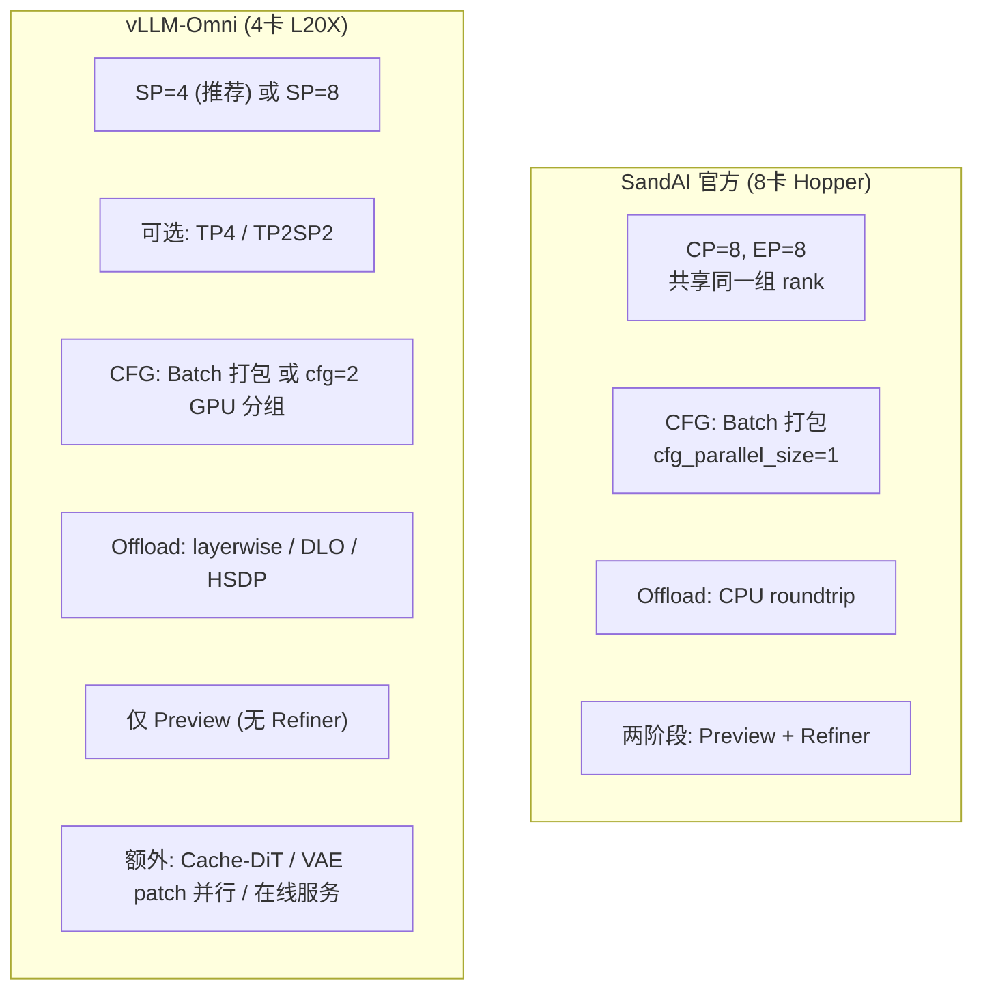

# MAGI-2 Preview 部署对比技术分析报告：SandAI 官方 vs vLLM-Omni

> 基于 SandAI 官方仓库（`MAGI-2-preview`）和 vLLM-Omni 仓库（`D:\codespace\vllm-omni`）源码逐文件分析。
> 所有结论标注对应代码位置，可回溯核对。

---

## 一、总览

MAGI-2 Preview 目前有两种部署方案：

| 维度 | SandAI 官方 | vLLM-Omni |
| --- | --- | --- |
| **代码仓库** | `SandAI-org/MAGI-2-preview` | `vllm-project/vllm-omni` |
| **运行时** | SandAI 自有推理代码 | vLLM-Omni 原生 pipeline（无 SandAI 运行时依赖） |
| **GPU 硬件** | 8 × NVIDIA Hopper (H100/H200) | 4 × NVIDIA L20X 140GiB（推荐）；兼容 8 GPU |
| **GPU 数量** | 固定 8 卡 | 4 卡（推荐）/ 1 卡（layerwise）/ 8 卡（配置验证） |
| **分辨率** | 1080p（含 Refiner） | 272p / 540p（仅 Preview，无 Refiner） |
| **并行策略** | CP=8 + EP=8（共享同一组 rank） | SP + 可选 TP + 可选 CFG 并行 + 可选 DP/DLO + 可选 HSDP |
| **CFG 实现** | Batch 打包（varlen batch=2） | Batch 打包（默认）或 GPU 分组并行（cfg_parallel_size=2） |
| **Offload** | CPU↔GPU roundtrip | layerwise / distributed layerwise (DLO) / HSDP |
| **在线服务** | 无（仅离线脚本） | OpenAI-compatible video API |
| **额外特性** | MagiAttention + MagiCompiler | Cache-DiT 加速、VAE patch 并行、多后端（CUDA/MUSA/NPU） |

来源：
- SandAI 官方：`README.md:31-36`、`configs/magi2_preview.json:2-9`
- vLLM-Omni：`recipes/SandAI/MAGI-2-preview-L20X.md:5-13`、`vllm_omni/diffusion/models/magi2/pipeline_magi2.py:5-14`

---

## 二、SandAI 官方部署

### 2.1 部署形态

```bash
# scripts/run_demo.sh
torchrun --nnodes=1 --nproc_per_node=8 inference/pipeline/entry.py \
    --resolution 1080p --seconds 10 --seed 42
```

- **固定 8 卡 Hopper**，`cp_size=8`，`ep_size=8`，`dp_size=1`
- CP 组 = EP 组 = 全部 8 rank（同一组 rank 承担两种角色）
- 两阶段生成：Preview（100 步，512×896）+ Refiner（5 步，1088×1920）
- Offload：text_enc=CPU, preview=ROUNDTRIP, refiner=ROUNDTRIP, vae=GPU

来源：`configs/magi2_preview.json:2-9`、`infra/distributed/psm.py:44-82`

### 2.2 并行策略

| 并行维度 | 值 | 机制 |
| --- | --- | --- |
| CP (Context Parallel) | 8 | Ulysses：散 head 聚 seq，FA3 全注意力 |
| EP (Expert Parallel) | 8 | MoE-head 分片：散 head 聚 seq（同 Ulysses 原语） |
| DP | 1 | 无数据并行 |
| TP | 无 | 未启用 |
| PP | 无 | 未启用 |
| CFG 并行 | 无 | Batch 打包（batch=2 varlen） |

关键特征：**CP 和 EP 共享同一组 8 rank**，两个 all-to-all 嵌套在同一个 TransformerLayer 内。

来源：`infra/distributed/psm.py:51-53`（`dp_size = world_size // cp_size = 1`）

### 2.3 CFG 实现：Batch 打包

```
cond + uncond → 拼成 batch=2 → SimplePackedData → cu_seqlens 隔离注意力 → 单次前向
```

- `sampler.py:164`：`batch_cfg = 2`
- `preview_data_proxy.py:358-368`：`SimplePackedData` 打包 cond+uncond
- FA3 varlen（`cu_seqlens_q/k`）保证 cond/uncond 注意力独立
- 无 GPU 级 CFG 并行（`dp_size=1`，无 CFG 分组）

---

## 三、vLLM-Omni 部署

### 3.1 部署形态

```bash
# recipes/SandAI/MAGI-2-preview-L20X.md:120-131
export CUDA_VISIBLE_DEVICES=0,1,2,3

python examples/offline_inference/text_to_video/text_to_video.py \
  --model "$MAGI2_CKPT_ROOT" \
  --model-class-name Magi2Pipeline \
  --prompt "A red fox walks through fresh snow..." \
  --height 512 --width 896 --num-frames 125 \
  --num-inference-steps 100 --fps 12.5 \
  --tensor-parallel-size 1 --ulysses-degree 4 \
  --extra-body '{"seconds":10,"resolution":"540p"}'
```

- **推荐 4 卡 L20X**（140GiB/卡），`TP=1`，`SP=4`（Ulysses degree=4）
- **仅 Preview 阶段**（272p/540p），不含 1080p Refiner
- 支持**在线服务**：`vllm serve --omni --model-class-name Magi2Pipeline`
- 运行时：**纯 vLLM-Omni 原生实现**，不导入 SandAI 代码

来源：`recipes/SandAI/MAGI-2-preview-L20X.md:5-13,120-131,179-208`

### 3.2 并行策略

vLLM-Omni 在 `DiffusionParallelConfig`（`vllm_omni/diffusion/data.py`）中定义了**一等公民级的并行维度**：

```python
@dataclass
class DiffusionParallelConfig:
    pipeline_parallel_size: int = 1
    data_parallel_size: int | None = None
    tensor_parallel_size: int = 1
    enable_expert_parallel: bool = False
    sequence_parallel_size: int | None = None  # = ulysses × ring × allgather
    ulysses_degree: int = 1
    cfg_parallel_size: int = 1       # ← CFG 并行（SandAI 没有）
    vae_patch_parallel_size: int = 1
    use_hsdp: bool = False            # ← HSDP 权重分片（SandAI 没有）
```

MAGI-2 支持的并行组合（`pipeline_magi2.py:248-370` 的 `_validate_native_topology`）：

| 并行维度 | SandAI 官方 | vLLM-Omni | 说明 |
| --- | --- | --- | --- |
| SP (Ulysses) | ✅ cp=8 | ✅ sp=4（推荐）或 sp=8 | 序列并行，散 head 聚 seq |
| TP | ❌ | ✅ tp=4 或 tp2sp2 | 张量并行，MoE-head 用 TP 而非 SP |
| EP | ✅ ep=8（=cp） | ✅ 但用 TP 或 SP 实现 | MoE-head 分片，复用 vLLM 的 TP/SP 组 |
| DP | ❌ dp=1 | ✅ dp=4 或 dp2sp2（需 DLO） | 数据并行，需 distributed layerwise offload |
| CFG 并行 | ❌ | ✅ cfg=2（4卡: cfg2×sp2, 8卡: cfg2×sp4） | GPU 分组并行 |
| HSDP | ❌ | ✅ hsdp4+sp4 | 混合分片数据并行 |
| DLO | ❌ | ✅ dp4/dp2sp2 | 分布式逐层 offload |
| VAE patch 并行 | ❌ | ✅ TurboVAE tile 并行 | VAE 解码加速 |
| Cache-DiT | ❌ | ✅ 近似缓存加速 | 跳过重复 transformer 层 |
| PP / Ring | ❌ | ❌ | 均不支持 |

**关键差异：TP 与 SP 的分离**

SandAI 官方：CP 和 EP 共享同一组 rank，两者用同一个 all-to-all 原语。
vLLM-Omni（`parallel.py:1-22`）：

```
* Ulysses context parallelism shards tokens and gathers attention heads.
* Multi-head expert parallelism shards the *MoE head* axis, not experts.

With SP-only deployment both views use the SP group.
With TP enabled, Ulysses keeps using SP while native column/row tensor
parallelism and the MoE heads use TP. This gives TP4 and TP2SP2
independent weight/head and token axes.
```

- SP-only（默认）：Ulysses 和 MoE-head 都用 SP 组（与 SandAI 相同）
- TP+SP：Ulysses 用 SP 组，MoE-head 用 TP 组（**SandAI 不支持**）

来源：`vllm_omni/diffusion/models/magi2/parallel.py:1-22,75-99`

### 3.3 拓扑约束

`_validate_native_topology`（`pipeline_magi2.py:248-370`）的关键约束：

```python
# world_size = DP * CFG * TP * SP
configured_world_size = dp_size * cfg_size * tp_size * sp_size

# 合法 worker 数: 1（layerwise）/ 4 / 8
if configured_world_size not in {4, 8} and not supported_single_worker:
    raise ValueError("MAGI-2 Preview is qualified for one worker with "
                     "ordinary layerwise offload, or four/eight workers")

# CFG 必须是 1 或 2
if cfg_size not in (1, 2):
    raise ValueError("MAGI-2 has exactly two CFG branches")

# CFG 和 DP 不能同时 > 1
if cfg_size > 1 and dp_size > 1:
    raise ValueError("MAGI-2 CFG parallelism is not yet combined with DLO data parallelism")

# DP 需要 DLO 且 TP=1
if dp_size > 1 and tp_size > 1:
    raise ValueError("MAGI-2 DLO data-parallel replicas currently require tensor_parallel_size=1")
```

### 3.4 性能数据

来自 `recipes/SandAI/MAGI-2-preview-L20X.md:265-271`：

| Profile | 工作负载 | 步数 | E2E 时间 | 峰值 HBM |
| --- | --- | ---: | ---: | ---: |
| DLO SP4 (4×L20X) | 540p T2VA | 100 | 563.9s | 见 PR |
| DLO SP4 (4×L20X) | 540p I2VA | 100 | 556.5s | 见 PR |
| Layerwise 1 GPU | 272p T2VA | 1 | 8.86s | 49.29 GiB |
| Layerwise 1 GPU | 272p T2VA | 4 | 42.55s | 49.29 GiB |

---

## 四、CFG 并行详解

### 4.1 CFG 并行的三种实现方式

| 方式 | 并行类型 | 代表 | 延迟 | GPU 需求 |
| --- | --- | --- | --- | --- |
| ① 顺序两遍 | 无并行 | SandAI Refiner | 2× | 1 组 |
| ② Batch 打包 | 时间并行（组 batch） | SandAI Preview / vLLM-Omni 默认 | ~1× | 1 组 |
| ③ GPU 分组并行 | 空间并行（跨 GPU） | **vLLM-Omni cfg_parallel_size=2** | ~1× | cfg_parallel_size 组 |

### 4.2 SandAI / vLLM-Omni 默认：Batch 打包

两套方案在 `cfg_parallel_size=1` 时使用相同的 Batch 打包机制：

**SandAI 官方**（`sampler.py:164-182`）：
```python
batch_cfg = 2
x_t = torch.cat([latent, latent], dim=0)           # cond + uncond
txt_feat = torch.cat([txt_feat, null_txt_feat])     # cond文本 + null文本
# → SimplePackedData → cu_seqlens → 单次前向
```

**vLLM-Omni**（`sampler_magi2.py:300-333`）：
```python
cfg_batch = batch_size * 2
x_t = torch.cat((latent, latent), dim=0)
txt_feat = torch.cat((txt_feat, null_txt_feat), dim=0)
# → data_proxy.process_input → 单次前向
```

两者机制完全相同：cond+uncond 拼成 batch=2，varlen attention 隔离，单次前向同时计算。

### 4.3 vLLM-Omni 独有：GPU 分组 CFG 并行

当 `cfg_parallel_size=2` 时，vLLM-Omni 启用**真正的 GPU 级 CFG 并行**（`sampler_magi2.py:190-215`）：

```python
if get_classifier_free_guidance_world_size() > 1:
    # 1. 拆分 cond/uncond 到不同 GPU 组
    positive_input, negative_input = self._split_cfg_model_input(model_input)

    # 2. 两组 GPU 分别计算（真并行）
    guided = self.predict_noise_maybe_with_cfg(
        do_true_cfg=True,
        positive_kwargs={"model_input": positive_input},   # rank 0 算 cond
        negative_kwargs={"model_input": negative_input},    # rank 1 算 uncond
    )
```

底层实现（`vllm_omni/diffusion/distributed/cfg_parallel.py:99-172`）：

```python
class CFGParallelMixin:
    def predict_noise_maybe_with_cfg(self, ...):
        if cfg_parallel_ready:  # cfg_world_size > 1
            # 每个 rank 只算一个分支
            if cfg_rank == 0:
                local_pred = self._predict_noise_for_cfg_branch("positive", ...)
            else:
                local_pred = self._predict_noise_for_cfg_branch("negative", ...)

            # AllGather 交换结果
            gathered = [cfg_group.all_gather(p, separate_tensors=True) for p in local_pred]
            positive_noise_pred = tuple(g[0] for g in gathered)
            negative_noise_pred = tuple(g[1] for g in gathered)

            # 所有 rank 本地合并（确定性，结果相同）
            return self.combine_cfg_noise(positive_noise_pred, negative_noise_pred, ...)
```

**通信原语**：`AllGather`（不是 All-to-All，不是 ReduceScatter）。每个 rank 计算一个分支后，用 AllGather 把结果广播给所有 rank，然后每个 rank 本地做 CFG 合并。

MAGI-2 的双模态 CFG 合并（`sampler_magi2.py:581-611`）：

```python
def combine_cfg_noise(self, positive, negative, ...):
    # positive/negative 各含 (video_pred, audio_pred)
    cfg_video, cfg_audio = self.cfg_velocity(
        (cat(positive[0], negative[0]), cat(positive[1], negative[1])),
        kwargs["video_txt_guidance_scale"],
        kwargs["audio_txt_guidance_scale"],
        ...
    )
    return cfg_video, cfg_audio
```

### 4.4 CFG 并行的拓扑配置

```
4 卡: CFG2×SP2
  GPU 0-1: CFG rank 0 (cond), SP=2
  GPU 2-3: CFG rank 1 (uncond), SP=2

8 卡: CFG2×SP4
  GPU 0-3: CFG rank 0 (cond), SP=4
  GPU 4-7: CFG rank 1 (uncond), SP=4
```

来源：`recipes/SandAI/MAGI-2-preview-L20X.md:223`

### 4.5 CFG 并行通信量对比

| 方式 | 每步前向次数 | 每卡通信 | 通信原语 |
| --- | --- | --- | --- |
| Batch 打包 (cfg=1) | 1（batch=2） | 1 组 SP all-to-all | All-to-All |
| GPU 分组 (cfg=2) | 1（每卡 1 分支） | 1 组 SP all-to-all + 1 次 AllGather | All-to-All + AllGather |
| 顺序两遍 (SandAI Refiner) | 2 | 2 组 SP all-to-all | All-to-All ×2 |

GPU 分组并行比 Batch 打 pack 多一次 AllGather，但每组 GPU 只算一半的 token（cond 或 uncond），计算量减半。Batch 打包不减少计算量（FLOPs 不变），只减少开销。

---

## 五、核心差异对比

### 5.1 并行架构对比



### 5.2 MoE 并行机制对比

| | SandAI 官方 | vLLM-Omni |
| --- | --- | --- |
| **EP 组来源** | 独立创建 EP 组（`psm.py:70-82`） | 复用 vLLM 的 TP 组或 SP 组（`parallel.py:75-99`） |
| **SP-only 时** | CP=EP=同一组 8 rank | SP=EP=同一组（与 SandAI 相同） |
| **TP 启用时** | 不支持 TP | Ulysses 用 SP，MoE-head 用 TP（独立轴） |
| **EP dispatch** | `all_to_all_single`（`magi2_preview.py:3297`） | `all_to_all_single`（`parallel.py:324`） |
| **Padding 处理** | head padding 12→16（`magi2_preview.py:2514-2538`） | 要求 `num_heads % (TP×SP) == 0`（`pipeline_magi2.py:282-286`） |

关键差异：vLLM-Omni 通过分离 TP 和 SP，让 MoE-head 并行可以独立于序列并行。SandAI 官方则把两者绑定在同一组 rank 上。

### 5.3 Offload 机制对比

| | SandAI 官方 | vLLM-Omni |
| --- | --- | --- |
| **策略** | CPU↔GPU roundtrip（整模型级别） | layerwise（逐层）/ DLO（分布式逐层）/ HSDP |
| **实现** | `OffloadUtils`（`offload_utils.py`） | `PinnedModuleStager` + DLO + HSDP |
| **粒度** | 整个模型在 CPU/GPU 间切换 | DiT 层级别流式 offload |
| **多卡 offload** | 无 | DLO AllGather（跨 rank 分片权重） |
| **单卡能力** | 不支持（8 卡才能跑） | 支持 layerwise 1 GPU（49.29 GiB HBM） |

vLLM-Omni 的 layerwise offload 让 MAGI-2 可以在**单卡 L20X** 上运行（272p，4 步，42.55s），这是 SandAI 官方做不到的。

### 5.4 生成能力对比

| | SandAI 官方 | vLLM-Omni |
| --- | --- | --- |
| **Preview 分辨率** | 512×896 | 448×256 (272p) / 896×512 (540p) |
| **Refiner** | ✅ 1080p（5 步精修） | ❌ 不含 |
| **最终输出** | 1088×1920 (1080p) | 最高 540p |
| **去噪步数** | Preview 100 + Refiner 5 | Preview 100（默认） |
| **时长** | 10 秒 | 10 秒 |
| **帧率** | 25 fps（refiner 后） | 12.5 fps |
| **音频** | ✅ 44.1kHz stereo | ✅ 44.1kHz stereo |

### 5.5 模型架构一致性

vLLM-Omni 的 `configuration_magi2.py` 与 SandAI 官方的 `magi2_preview.json` 完全一致：

```python
# vLLM-Omni configuration_magi2.py
num_layers: int = 40
hidden_size: int = 3072
head_dim: int = 128
num_query_groups: int = 24
moe: num_heads=12, num_experts=256, top_k=6
mhc: num_streams=4, alpha_init=0.01
attention_sink_tokens=1, attention_gating=True
```

`parallel.py` 头部注释明确说明：
```
This file is adapted from SandAI's Apache-2.0 MAGI-2 preview context-
and expert-parallel primitives.
```

`sampler_magi2.py` 头部注释：
```
The CFG and denoising math is adapted from SandAI's Apache-2.0 MAGI-2
Preview inference implementation.
```

来源：`vllm_omni/diffusion/models/magi2/configuration_magi2.py:50-66`、`parallel.py:5-9`、`sampler_magi2.py:5-11`

---

## 六、部署 Profile 对比

### SandAI 官方（唯一 profile）

```
8 × Hopper GPU
cp=8, ep=8, dp=1, cfg=1 (batch 打包)
CPU roundtrip offload
Preview 100步 + Refiner 5步 → 1080p
```

### vLLM-Omni 支持的 Profile

| Profile | GPU | 拓扑 | 用途 | 质量 |
| --- | ---: | --- | --- | --- |
| Resident SP4 | 4 | TP=1, SP=4 | 推荐默认部署 | 参考对齐 |
| DLO SP4 | 4 | DP=1, SP=4, DLO | 全质量低 HBM | 100步 T2VA/I2VA |
| DLO DP4 / DP2SP2 | 4 | DP=4 或 DP2SP2 | 并发吞吐 | 有限覆盖 |
| Layerwise 1 GPU | 1 | layerwise offload | 内存受限单请求 | 1步/4步 |
| Online SP4 | 4 | TP=1, SP=4 | OpenAI API 服务 | 服务路径 |
| CFG2×SP2 | 4 | CFG=2, SP=2 | CFG 并行 | 配置验证 |
| CFG2×SP4 | 8 | CFG=2, SP=4 | CFG 并行（8卡） | 配置验证 |
| HSDP4+SP4 | 4 | HSDP+SP4 | 权重分片 | 配置验证 |
| TP4 / TP2SP2 | 4 | TP=4 或 TP=2,SP=2 | 张量并行 | 配置验证 |

来源：`recipes/SandAI/MAGI-2-preview-L20X.md:40-48,217-228`

---

## 七、总结

### 7.1 vLLM-Omni 相比 SandAI 官方的优势

1. **更少 GPU**：4 卡 L20X 即可运行（SandAI 需 8 卡 Hopper）
2. **单卡能力**：layerwise offload 支持单卡运行（SandAI 不支持）
3. **CFG 并行**：支持 GPU 分组 CFG 并行（`cfg_parallel_size=2`），SandAI 仅 batch 打包
4. **并行维度丰富**：TP、DP、HSDP、DLO、CFG、VAE patch 等可选（SandAI 仅 CP+EP）
5. **在线服务**：OpenAI-compatible video API（SandAI 仅离线脚本）
6. **加速特性**：Cache-DiT 近似缓存加速
7. **多后端**：CUDA / MUSA (Moore Threads) / NPU (Huawei) 三套后端

### 7.2 SandAI 官方相比 vLLM-Omni 的优势

1. **完整生成**：含 1080p Refiner（vLLM-Omni 仅 Preview 272p/540p）
2. **更高分辨率**：输出 1080p（vLLM-Omni 最高 540p）
3. **更高帧率**：25 fps（Refiner 翻倍），vLLM-Omni 12.5 fps
4. **原生优化**：MagiAttention + MagiCompiler 自定义内核
5. **确定性模式**：完整确定性支持（vLLM-Omni 也支持但 warn_only）

### 7.3 核心设计差异

SandAI 官方选择了**固定 8 卡 Hopper + CP/EP 共享 + CPU roundtrip** 的方案，追求最高质量输出（1080p），但部署门槛高。

vLLM-Omni 选择了**灵活拓扑 + 多级 offload + 丰富并行维度**的方案，追求部署灵活性和更低门槛（4 卡甚至 1 卡），但暂不支持 Refiner（仅 540p）。

两者在模型架构（40 层 DiT + MagiMoE + MHC）、MoE 路由（12 head × 256 expert, top-6）、Attention 结构（FA3 + sink + gating + QK norm + 3D RoPE）上完全一致，差异仅在部署形态和并行策略。

---

## 八、NPU 部署形态分析

vLLM-Omni 除了 CUDA 后端外，还支持在华为 Ascend NPU 上部署 MAGI-2。以下基于 `recipes/SandAI/MAGI-2-preview-NPU.md` 和 `vllm_omni/diffusion/models/magi2/layers/npu/` 源码分析。

### 8.1 NPU 部署形态

```bash
# recipes/SandAI/MAGI-2-preview-NPU.md:100-118
export VLLM_TARGET_DEVICE=npu
export ASCEND_RT_VISIBLE_DEVICES=0,1,2,3
export VLLM_USE_BREAKABLE_CUDAGRAPH=0
export PYTORCH_NPU_ALLOC_CONF=expandable_segments:True

vllm serve "$MODEL_PATH" --omni --model-class-name Magi2Pipeline \
  --num-gpus 4 --tensor-parallel-size 1 --ulysses-degree 4 \
  --enforce-eager --host 127.0.0.1 --port "$PORT" \
  --stage-overrides '{"0":{"pin_cpu_memory":false}}'
```

| 维度 | NPU Profile |
| --- | --- |
| **加速器** | NPU（华为 Ascend） |
| **单卡显存** | 112 GiB |
| **卡数** | 4 |
| **拓扑** | TP=1, SP=4（Ulysses） |
| **精度** | BF16 |
| **执行模式** | **eager only**（`--enforce-eager`） |
| **CUDA Graph** | **禁用**（`VLLM_USE_BREAKABLE_CUDAGRAPH=0`） |
| **Pinned memory** | **禁用**（`pin_cpu_memory=false`） |
| **任务** | 仅在线 T2VA |
| **分辨率** | 仅 272p（448×256） |
| **步数** | 100 步 |
| **Refiner** | 不含 |
| **I2VA / 540p / 离线** | **未验证** |

来源：`recipes/SandAI/MAGI-2-preview-NPU.md:9-27,62-74,100-118`

### 8.2 NPU 软件栈

| 组件 | 版本 |
| --- | --- |
| 容器镜像 | `quay.io/ascend/vllm-omni:nightly-20261021` |
| Host OS | openEuler 24.03 LTS-SP2 |
| Ascend runtime | CANN 9.1.0 |
| PyTorch / torch_npu | 2.10.0+cpu / 2.10.0.post4 |
| vLLM | 0.32.0+empty |
| vLLM-Ascend | commit `450e55698` |

来源：`recipes/SandAI/MAGI-2-preview-NPU.md:76-89`

### 8.3 NPU 内核适配——逐组件分析

vLLM-Omni 为 MAGI-2 的每个关键组件提供了 NPU 专用实现，位于 `vllm_omni/diffusion/models/magi2/layers/npu/`。所有 NPU 实现都继承自 native（PyTorch）实现，在检测到 NPU 设备时切换到 Ascend 算子。

#### 8.3.1 Attention：Ascend 融合注意力

**CUDA 路径**（`layers/cuda/attention_ops.py:64-76`）：使用 FlashAttention 2/3/4（自动选择），通过 LSE 修正实现 sink token。

**NPU 路径**（`layers/npu/attention_ops.py:15-75`）：

```python
output, _ = torch_npu.npu_fused_infer_attention_score_v2(
    q.contiguous(), k.contiguous(), v.contiguous(),
    actual_seq_qlen=actual_q,
    actual_seq_kvlen=actual_kv,
    learnable_sink=learnable_sink,    # ← sink 处理方式不同
    num_query_heads=q.shape[1],
    num_key_value_heads=k.shape[1],
    softmax_scale=q.shape[-1] ** -0.5,
    input_layout="TND",               # ← Token-Head-Dim 布局
    sparse_mode=0,
    return_softmax_lse=False,
)
```

关键差异：

| | CUDA (FlashAttention) | NPU (Ascend FA v2) |
| --- | --- | --- |
| **算子** | `flash_attn_3_cuda.fwd` | `npu_fused_infer_attention_score_v2` |
| **输入布局** | batch 优先 (BSHD) | Token 优先 (TND) |
| **Sink 处理** | FA3 输出 + LSE 数值修正 | `logsumexp` 折叠为单 logit |
| **Softcap** | FA3 原生支持 | **不支持**（回退到 native） |
| **版本选择** | FA2/3/4 自动选择 | 仅 Ascend v2 |

NPU 的 sink 处理特别值得注意（`attention_ops.py:50-59`）：
```python
# Ascend op 只接受每个 query head 一个 sink logit
# MAGI-2 的多个 sink logits 通过 logsumexp 折叠为一个
learnable_sink = torch.logsumexp(sink.float(), dim=0)
```

CUDA 路径通过 FA3 的 LSE（log-sum-exp）输出做精确数值修正来实现 sink；NPU 路径则预先把 sink 参数折叠成一个 logit 输入 Ascend 算子。两者数学等价但实现路径不同。

#### 8.3.2 MoE：Ascend 分组矩阵乘

**SandAI 官方**（`flash_mh_moe/triton/mh_moe_fwd.py`）：Triton kernel 实现 gather → GEMM → SwiGLU → GEMM → scatter，全融合。

**NPU 路径**（`layers/npu/mh_moe.py:18-95`）：

```python
# 1. 路由排序
routed = torch_npu.npu_moe_init_routing_v2(
    flat_x, flat_ids, active_num=..., expert_num=num_flat_experts, ...
)

# 2. 分组 GEMM（gate + up）
gate = torch_npu.npu_grouped_matmul(x=[sorted_hidden], weight=[w_gate], ...)
up = torch_npu.npu_grouped_matmul(x=[sorted_hidden], weight=[w_up], ...)

# 3. SwiGLU7 激活（复用 native 实现，未融合）
hidden = swiglu7_pair(gate, up)

# 4. 分组 GEMM（down）
sorted_output = torch_npu.npu_grouped_matmul(x=[hidden], weight=[w_down], ...)

# 5. 反路由散播
output = torch_npu.npu_moe_token_unpermute(
    permuted_tokens=sorted_output,
    sorted_indices=torch.abs(expanded_row_idx),
    probs=flat_probs,
)
```

关键差异：

| | SandAI 官方 (Triton) | vLLM-Omni CUDA | vLLM-Omni NPU |
| --- | --- | --- | --- |
| **路由排序** | PyTorch argsort | PyTorch argsort | `npu_moe_init_routing_v2` |
| **GEMM** | Triton 融合 kernel | Triton/CUTLASS | `npu_grouped_matmul` |
| **SwiGLU7** | Triton 内融合 | native | **native（未融合）** |
| **Scatter** | Triton atomic_add | Triton/CUDA | `npu_moe_token_unpermute` |
| **专家数限制** | 无 | 无 | **≤1024 局部专家组** |

**1024 专家限制**（`mh_moe.py:40-44`）：
```python
if num_flat_experts > 1024:
    raise ValueError(
        "Ascend grouped MatMul supports at most 1024 local expert groups; "
        f"got {heads} heads x {num_experts} experts. Use SP/TP head sharding."
    )
```

MAGI-2 有 12 heads × 256 experts = 3072 扁平化专家。NPU 的 `npu_grouped_matmul` 最多支持 1024 个局部专家组。因此 **NPU 必须使用 SP 或 TP 分片**将每卡局部专家数降到 1024 以下：
- SP=4：每卡 12/4 = 3 heads × 256 = 768 专家 ✅
- SP=2：每卡 12/2 = 6 heads × 256 = 1536 专家 ❌（超过 1024）
- SP=1：12 × 256 = 3072 ❌

这就是 NPU recipe 固定使用 SP=4 的根本原因。

#### 8.3.3 RMSNorm

**NPU 路径**（`layers/npu/normalization.py:15-40`）：

```python
# 单模态
result = torch_npu.npu_rms_norm(compute, gamma=weights[0], epsilon=self.eps)[0]

# 多模态：按模态分组，各自调 npu_rms_norm
outputs = [
    torch_npu.npu_rms_norm(part, gamma=weights[index], epsilon=self.eps)[0]
    for index, part in enumerate(inputs)
]
```

使用 `torch_npu.npu_rms_norm` 替代 SandAI 官方的 Triton `_grouped_multi_head_rms_norm_fwd_kernel`。多模态处理逻辑保持一致（按模态分发 → 各自归一化 → 合并）。

#### 8.3.4 RoPE

**NPU 路径**（`layers/npu/rope.py:15-39`）：

```python
rotated = apply_rotary_emb_torch_npu(
    x[..., :rotary_dim].contiguous(),
    cos.to(x.dtype), sin.to(x.dtype),
    interleaved=False,
    half_head_dim=True,
)
```

使用 vLLM-Omni 共享的 NPU 融合 rotary kernel `apply_rotary_emb_torch_npu`。仅在满足 batch-angle 契约（cos/sin 同 ndim、batch=1）时激活，否则回退到 native PyTorch 实现。

### 8.4 三后端完整对比

vLLM-Omni 的 MAGI-2 实现支持三种后端，通过 `layers/{cuda,native,npu}/` 目录分离：

| 组件 | SandAI 官方 | vLLM-Omni CUDA | vLLM-Omni Native | vLLM-Omni NPU |
| --- | --- | --- | --- | --- |
| **Attention** | FA3 (`flash_attn_3_cuda`) | FA2/3/4 自动选择 | PyTorch SDPA | `npu_fused_infer_attention_score_v2` |
| **MoE GEMM** | Triton 融合 kernel | Triton/CUTLASS | PyTorch grouped linear | `npu_grouped_matmul` |
| **MoE 路由** | PyTorch argsort | PyTorch argsort | PyTorch argsort | `npu_moe_init_routing_v2` |
| **MoE Scatter** | Triton atomic_add | Triton/CUDA | PyTorch scatter_add | `npu_moe_token_unpermute` |
| **RMSNorm** | Triton kernel | Triton/CUDA | PyTorch | `npu_rms_norm` |
| **RoPE** | PyTorch | PyTorch 或 FA fused | PyTorch | `apply_rotary_emb_torch_npu` |
| **Sink 处理** | FA3 LSE 修正 | FA LSE 修正 | 数值修正 | `logsumexp` 折叠 |
| **编译** | MagiCompiler | torch.compile regional | 无 | **eager only** |
| **CUDA Graph** | N/A | 可选 | 无 | **禁用** |
| **专家限制** | 无 | 无 | 无 | **≤1024** |
| **Pinned memory** | ✅ | ✅ | ✅ | **❌** |
| **MUSA 后端** | ❌ | ❌ | ❌ | ❌（独立 layers/musa/） |

> 注：vLLM-Omni 还有第四个后端 `layers/musa/`（Moore Threads MUSA），但 MAGI-2 的 MUSA 支持尚在实验阶段，无 recipe 文档。

### 8.5 NPU 部署约束总结

| 约束 | 原因 | 影响 |
| --- | --- | --- |
| **必须 SP≥4** | `npu_grouped_matmul` 限 1024 专家，12×256=3072 需分片到 ≤768 | SP=2 不可用（1536>1024） |
| **eager only** | NPU 不支持 CUDA Graph 和 torch.compile regional | 无图捕获加速 |
| **无 pinned memory** | NPU pinned staging 未实现 | CPU offload 更慢 |
| **无 softcap** | Ascend attention op 不支持 softcap 参数 | MAGI-2 softcap=-1（未启用），无实际影响 |
| **仅 272p T2VA** | NPU 验证范围有限 | 540p/I2VA/离线/其他并行未验证 |
| **单 sink logit** | Ascend op 只接受 1 个 sink logit/head | MAGI-2 用 1 sink token，logsumexp 折叠后恰好兼容 |

### 8.6 NPU vs CUDA vs SandAI 官方部署对比

| 维度 | SandAI 官方 | vLLM-Omni CUDA (L20X) | vLLM-Omni NPU (Ascend) |
| --- | --- | --- | --- |
| **加速器** | 8× Hopper GPU | 4× L20X GPU | 4× Ascend NPU |
| **单卡显存** | 80 GiB (H100) | 140 GiB | 112 GiB |
| **总显存** | 640 GiB | 560 GiB | 448 GiB |
| **并行** | CP=8, EP=8 | SP=4（默认），可选 TP/DP/CFG/HSDP | SP=4 only |
| **CFG** | Batch 打包 | Batch 打包 或 GPU 分组 | Batch 打包（CFG 并行未验证） |
| **Offload** | CPU roundtrip | layerwise / DLO / HSDP | 辅助组件 CPU staging（无 pinned） |
| **执行模式** | MagiCompiler 编译 | torch.compile + 可选 CUDA Graph | **eager only** |
| **分辨率** | 1080p（含 Refiner） | 272p / 540p | **仅 272p** |
| **任务** | T2V / I2V | T2VA / I2VA | **仅 T2VA** |
| **在线服务** | ❌ | ✅ OpenAI API | ✅ OpenAI API |
| **内核生态** | FA3 + MagiAttention + Triton | FA2/3/4 + Triton + CUTLASS | Ascend CANN 算子 |
| **MoE 内核** | Triton 全融合 | Triton/CUTLASS | `npu_grouped_matmul`（非融合） |

### 8.7 NPU 部署的意义

1. **国产硬件适配**：MAGI-2 可以在华为 Ascend NPU 上运行，不依赖 NVIDIA GPU，对国产化部署场景有重要意义。

2. **多后端架构**：vLLM-Omni 的 `layers/{cuda,native,npu}/` 目录设计让同一套模型代码适配三种后端，NPU 实现继承 native 实现，仅在算子级别替换。这种设计降低了跨平台适配的成本。

3. **1024 专家限制的启示**：NPU 的 `npu_grouped_matmul` 有 1024 专家组限制，这直接决定了 NPU 部署必须 SP≥4。这是硬件算子约束反推并行策略的典型案例——不是"想用什么并行"而是"硬件限制只能用什么并行"。

4. **eager 模式的代价**：NPU 不支持 CUDA Graph 和 torch.compile，所有执行都在 eager 模式。这意味着 NPU 部署的性能会显著低于 CUDA（无法通过图捕获减少 kernel launch 开销）。但 MAGI-2 的 100 步去噪中，每步的计算量远大于 launch 开销，所以 eager 模式的相对代价没有 LLM 那么大。

5. **验证范围有限**：NPU recipe 明确标注仅验证了 272p T2VA 在线服务，其他配置（540p、I2VA、离线、TP、DP、CFG、HSDP、DLO、Cache-DiT）均为"not qualified by this NPU run"。这表明 NPU 支持处于早期阶段，功能完整性不及 CUDA。
